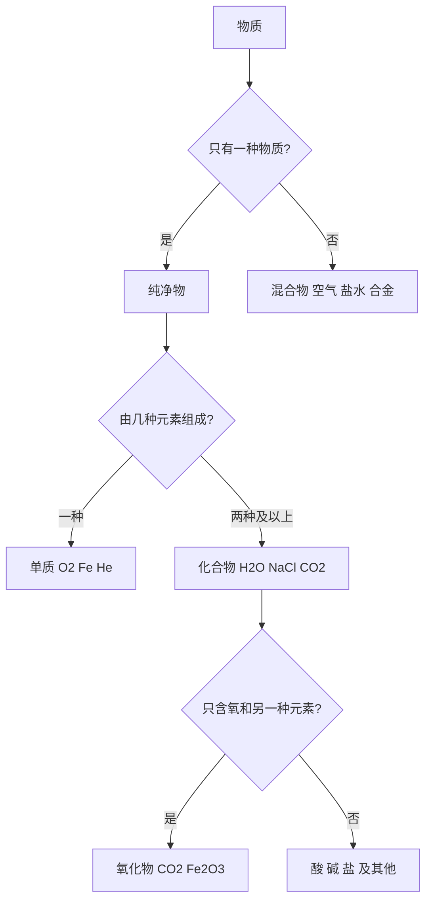

# 第 1 章：物质怎么分类

- **难度**：★☆☆ | **预估学时**：0.5 小时 | **前置**：无

## 学习目标
学完本章，你能：
1. 拿到一个名字，判断它是纯净物还是混合物；
2. 区分单质、化合物、氧化物；
3. 用一张分类树把初中见过的物质归位。

## 一句话核心
分类只看两件事：**里面是不是只有一种东西**，以及**它由几种元素组成**。

## 零基础讲解

### 概念 1：纯净物与混合物（难度：基础）

**纯净物**是只由一种物质组成的体系，有固定的化学式，比如蒸馏水 H₂O、干冰 CO₂、液氧 O₂。**混合物**里至少有两种物质，各成分保持自己的性质，没有统一化学式，比如空气、食盐水、合金、牛奶。

判断的关键不是"看起来干净"，而是"能不能写出唯一的化学式"。空气很干净，但它由 N₂、O₂、Ar、CO₂ 等组成，是混合物。澄清石灰水看着透明，里面是 Ca(OH)₂ 和水，也是混合物。

### 概念 2：单质与化合物（难度：基础）

只由**一种元素**组成的纯净物叫**单质**，如 O₂、Fe、He。由**两种或以上元素**组成的纯净物叫**化合物**，如 H₂O、NaCl、CO₂。

注意，O₂ 和 O₃ 都是单质，混合在一起（臭氧和氧气的混合气）就是混合物，因为它们是两种不同的物质。

### 概念 3：氧化物、酸、碱、盐（难度：基础）

**氧化物**：只含两种元素，其中一种是氧，如 CO₂、Fe₂O₃、SO₂。NaOH 含三种元素，不算氧化物；H₂O₂ 虽然只含 H、O，但它是过氧化物，中学阶段单独记，不归入普通氧化物。

**酸**：电离时产生的阳离子全部是 H⁺ 的化合物，如 HCl、H₂SO₄、CH₃COOH。
**碱**：电离时产生的阴离子全部是 OH⁻ 的化合物，如 NaOH、Ca(OH)₂、NH₃·H₂O。
**盐**：由金属阳离子（或 NH₄⁺）与酸根阴离子组成的化合物，如 NaCl、Na₂CO₃、CuSO₄。

## 图示

看图说明：从"是不是一种物质"开始分叉，再按元素种类往下走。每一步只问一个问题，避免同时判断两件事。

## 类比与实例

类比：整理衣柜。先把"一件衣服"和"一堆衣服"分开（纯净物/混合物），再看这件衣服是纯棉还是混纺（单质/化合物）。这个类比在"同素异形体"处失效：O₂ 和 O₃ 是两种"衣服"，但用的是同一种"布料"。

实例：判断下列物质——
- 空气：混合物（N₂、O₂、CO₂ 等多种物质）
- 液氧：纯净物、单质（只有 O 元素）
- 干冰：纯净物、化合物、氧化物（CO₂）
- 食盐水：混合物（NaCl + H₂O）
- 生铁：混合物（Fe 与 C 等）
- 氧化铜 CuO：纯净物、化合物、氧化物

## 常见误解
- 别以为"透明的、干净的就是纯净物"——澄清石灰水是混合物，蒸馏水才是纯净物。
- 别以为"冰水混合物"是混合物——冰和水都是 H₂O，它是纯净物，只是状态不同。
- 别以为"含氧的化合物都是氧化物"——NaOH 含氧但含三种元素，不是氧化物。

## 自测题（答案）
1. 下列属于纯净物的是（ ）。A. 洁净的空气 B. 冰水混合物 C. 生理盐水 D. 大理石
（答案：B；解析：冰和水都是 H₂O，只有一种物质。A、C、D 都含多种物质。）

2. 下列物质中属于氧化物的是（ ）。A. O₂ B. KClO₃ C. Fe₃O₄ D. H₂SO₄
（答案：C；解析：Fe₃O₄ 只含 Fe、O 两种元素。A 是单质，B、D 含三种元素。）

3. 判断："臭氧（O₃）和氧气（O₂）混合在一起，因为都只含氧元素，所以是纯净物。"这句话对吗？
（答案：不对。O₃ 和 O₂ 是两种不同物质，混合后是混合物。）

## 复习锚点
- 纯净物看"一种物质 + 固定化学式"，混合物看"多种物质"。
- 单质按元素种类数判定，和状态、颜色无关。
- 氧化物必须是"两种元素，其中一种是氧"。
