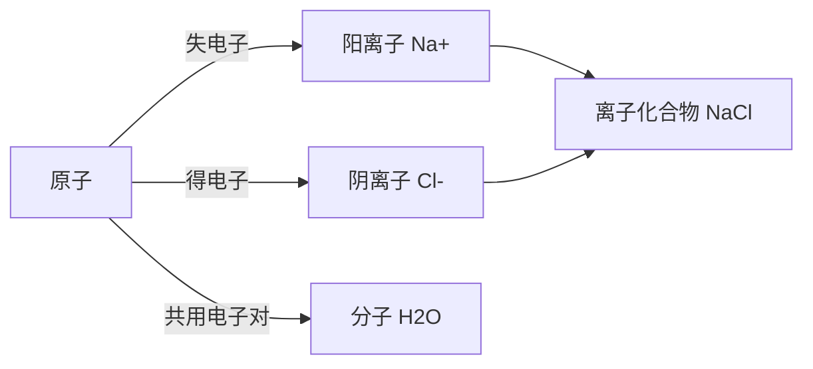

# 第 2 章：原子、分子、离子

- **难度**：★☆☆ | **预估学时**：0.7 小时 | **前置**：第 1 章

## 学习目标
学完本章，你能：
1. 说清原子、分子、离子三者的关系；
2. 数出一个原子的质子数、中子数、电子数；
3. 解释 Na 变成 Na⁺、Cl 变成 Cl⁻ 时到底发生了什么。

## 一句话核心
化学反应只动**最外层电子**，原子核不变；粒子带电与否，取决于质子数和电子数是否相等。

## 零基础讲解

### 概念 1：原子的三个零件（难度：基础）

原子由**质子**（带正电）、**中子**（不带电）、**电子**（带负电）组成。质子集中在中心的原子核里，电子在核外分层运动。

三条恒等式先记住：
- 核电荷数 = 质子数 = 原子序数（元素在周期表里的序号）
- 质量数 = 质子数 + 中子数（电子质量太小，忽略）
- 中性原子：质子数 = 电子数

举例：¹²C 有 6 个质子、6 个中子、6 个电子；²³Na 有 11 个质子、12 个中子、11 个电子。

### 概念 2：分子（难度：基础）

**分子**是保持物质化学性质的最小微粒。水由 H₂O 分子构成，每个分子里 2 个 H 原子和 1 个 O 原子以共价键相连。氧气是 O₂ 分子，二氧化碳是 CO₂ 分子。

不是所有物质都由分子构成。NaCl 由 Na⁺ 和 Cl⁻ 按 1:1 排列成离子晶体，里面没有"NaCl 分子"；铁由 Fe 原子紧密堆积而成。所以"分子是保持化学性质的最小微粒"这句话，只对分子构成的物质成立。

### 概念 3：离子（难度：基础）

原子失去电子变成**阳离子**，得到电子变成**阴离子**。

- Na 原子（11 质子、11 电子）失去 1 个电子 → Na⁺（11 质子、10 电子），带 1 个单位正电。
- Cl 原子（17 质子、17 电子）得到 1 个电子 → Cl⁻（17 质子、18 电子），带 1 个单位负电。

离子所带电荷数 = 质子数 − 电子数（带符号）。这句是后面写离子方程式、判断化合价的基础。

## 图示

看图说明：原子有三条去向——失电子、得电子、共用电子。前两条形成离子，第三条形成分子。

## 类比与实例

类比：原子像一个收支平衡的小公司，质子数是"固定资产"（不会变），电子是"流动资金"（可以借进借出）。借出电子就带正电，借进电子就带负电。这个类比在"原子核也会变"的核反应中失效。

实例：计算 OH⁻ 的质子数和电子数。O 有 8 个质子，H 有 1 个，共 9 个质子；OH⁻ 带 1 个单位负电，说明电子比质子多 1 个，电子数 = 10。核外电子总数算对了，写电子式才不会错。

## 常见误解
- 别以为"原子一定比分子小"——CO₂ 分子里 3 个原子，但一个 CO₂ 分子当然比一个 C 原子重；反过来，一个蛋白质分子比一个 H 原子大得多。大小要拿具体对象比。
- 别以为"离子只能在水溶液里存在"——NaCl 固体里就有 Na⁺ 和 Cl⁻，只是不能自由移动，所以不导电。
- 别以为"失电子后质量变小很多"——电子质量约是质子的 1/1836，得失一两个电子，质量几乎不变。

## 自测题（答案）
1. ¹⁷O 的质子数、中子数、电子数分别是（ ）。A. 8、9、8 B. 9、8、9 C. 8、9、9 D. 17、8、17
（答案：A；解析：O 的原子序数 8，质子数 8；质量数 17，中子数 17−8=9；中性原子电子数=质子数=8。）

2. Mg²⁺ 的质子数为 12，则它的电子数为（ ）。
（答案：10；解析：带 2 个单位正电，电子比质子少 2 个。）

3. 判断："NaCl 固体不导电，所以 NaCl 固体中不存在离子。"
（答案：不对。NaCl 固体中有 Na⁺ 和 Cl⁻，但离子被固定在晶格中，不能自由移动，因此不导电。）

## 复习锚点
- 质子数决定元素种类，中子数决定同位素，电子数决定带电情况。
- 阳离子电子数 = 质子数 − 电荷数；阴离子电子数 = 质子数 + 电荷数绝对值。
- 不是所有物质都由分子构成。
