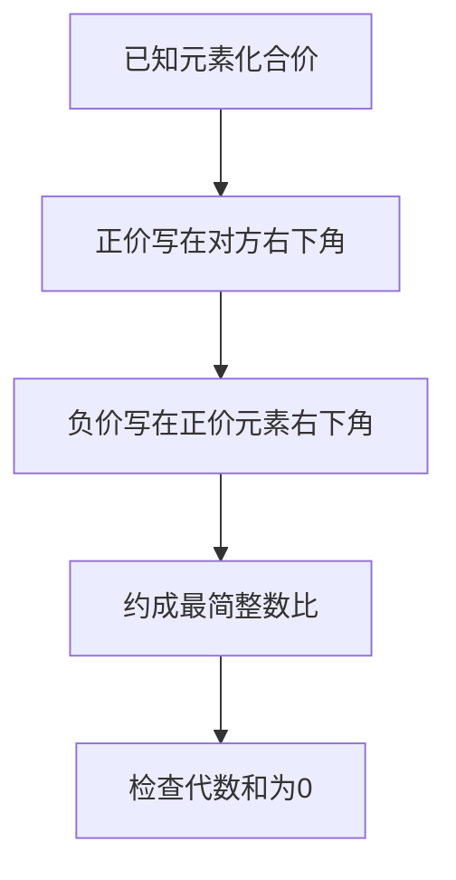

# 第 3 章：化学式与化合价

- **难度**：★☆☆ | **预估学时**：0.8 小时 | **前置**：第 1、2 章

## 学习目标
学完本章，你能：
1. 根据名称写出常见物质的化学式；
2. 用化合价规则检查化学式对不对；
3. 用"十字交叉法"由化合价写出化学式。

## 一句话核心
化学式是物质的"配方标签"：元素种类不能错，原子个数必须让正负化合价代数和为零。

## 零基础讲解

### 概念 1：元素符号与化学式（难度：基础）

**元素符号**是国际通用的元素缩写，H、O、C、Na、Cl、Fe。第一个字母大写，第二个字母小写：Cu 是铜，CU 是错误写法。

**化学式**用元素符号表示物质的组成。H₂O 表示每个水分子有 2 个 H、1 个 O；NaCl 表示 Na⁺ 与 Cl⁻ 的个数比为 1:1。化学式右下角的数字叫**下标**，表示原子个数，读的时候不读出来。

### 概念 2：化合价（难度：基础）

**化合价**表示元素在形成化合物时得失电子（或电子对偏移）的数目，有正负之分。几条常用规则：
- 单质中元素化合价为 0：O₂ 中 O 为 0，Fe 中 Fe 为 0。
- 化合物中 H 通常为 +1，O 通常为 −2。
- 金属元素显正价，非金属元素常显负价。
- 任何化合物中，各元素化合价的代数和为 0。

常见要背的：Na +1、K +1、Ca +2、Mg +2、Al +3、Fe +2/+3、Cu +2、Zn +2、H +1、O −2、Cl −1（氯化物中）、S −2（硫化物中）。

### 概念 3：由化合价写化学式（难度：基础）

以氧化铝为例。Al 为 +3，O 为 −2。要让正负化合价代数和为 0，取 3 和 2 的最小公倍数 6：需要 2 个 Al（+6）和 3 个 O（−6），写成 Al₂O₃。

操作上有个"十字交叉法"：把化合价绝对值交叉写到对方元素右下角，再约分。
- Al(+3)、O(−2) → Al₂O₃
- Ca(+2)、Cl(−1) → CaCl₂
- Fe(+3)、O(−2) → Fe₂O₃

### 概念 4：原子团（难度：基础）

多个原子常作为一个整体参加反应，叫**原子团**（根）。常见的有 OH⁻、NO₃⁻、SO₄²⁻、CO₃²⁻、NH₄⁺、HCO₃⁻。写化学式时原子团要加括号：Ca(OH)₂、Al₂(SO₄)₃，括号外的数字属于整个原子团。

## 图示

看图说明：十字交叉法只是把"代数和为零"这一步做成机械操作。最后一步检查不能省。

## 类比与实例

类比：化学式像配平天平。左边放正价砝码，右边放负价砝码，两边必须一样重。这个类比在过氧化物、超氧化物里失效，因为氧的化合价不是 −2（如 H₂O₂ 中 O 为 −1）。

实例：写硫酸铁。Fe 为 +3，SO₄ 为 −2。交叉得 Fe₂(SO₄)₃：2 个 Fe 共 +6，3 个 SO₄ 共 −6，代数和为 0。检查：Fe₂(SO₄)₃ 中 S 为 +6、O 为 −2，每个 SO₄ 为 −2，正确。

## 常见误解
- 别以为"下标可以随便改来配平"——化学式由物质本身决定，配平时只能改前面的系数，绝不能改下标。
- 别以为"化合价就是原子实际得失的电子数"——在共价化合物里，化合价是电子对偏移的结果，不是完全得失。
- 别以为"Ca(OH)₂ 的括号可以省"——省了会变成 CaOH₂，含义完全不同。

## 自测题（答案）
1. 氧化铁的化学式是（ ）。A. FeO B. Fe₂O₃ C. Fe₃O₄ D. Fe(OH)₃
（答案：B；解析：铁为 +3，氧为 −2，交叉得 Fe₂O₃。）

2. 下列化学式书写正确的是（ ）。A. Na₂CO₃ B. NaCO₃ C. NaCl₂ D. CaOH₂
（答案：A；解析：Na 为 +1，CO₃ 为 −2，需要 2 个 Na；B 电荷不平，C 钠应为 +1 与 −1 的 Cl 配 1:1，D 缺括号。）

3. 计算 KMnO₄ 中 Mn 的化合价。
（答案：+7；解析：K 为 +1，O 为 −2，设 Mn 为 x，1 + x + 4×(−2) = 0，x = +7。）

## 复习锚点
- 化学式对错看两条：元素种类对不对、化合价代数和是不是零。
- 常见化合价先背金属和 H、O、Cl、S。
- 原子团要当作一个整体，写式子时加括号。
