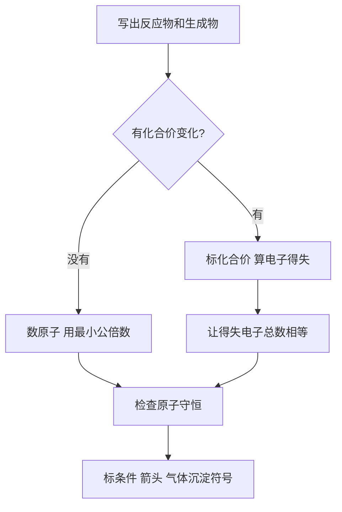

# 第 4 章：化学方程式与配平

- **难度**：★★☆ | **预估学时**：1 小时 | **前置**：第 3 章

## 学习目标
学完本章，你能：
1. 说清化学方程式为什么必须配平；
2. 用最小公倍数法配平常见方程式；
3. 检查配平后的方程式（原子守恒、电荷守恒、条件标注）。

## 一句话核心
方程式是化学反应的"账单"：反应前后每种元素的原子个数必须一模一样，只能改系数，不能改下标。

## 零基础讲解

### 概念 1：质量守恒（难度：基础）

化学反应中原子不会被消灭，也不会凭空产生，只是重新组合。所以反应前后每种元素的原子总数相等，这就是**质量守恒定律**。

写方程式时，反应物写左边，生成物写右边，中间用箭头。箭头上面标条件：点燃、加热（△）、催化剂、高温。气体生成物标 ↑，沉淀标 ↓，但如果是反应物里本来就有气体，就不标。

### 概念 2：配平的步骤（难度：进阶）

以丙烷燃烧为例：C₃H₈ + O₂ → CO₂ + H₂O。

第一步，先配 C 和 H，最后配 O。左边 3 个 C，右边先写 3CO₂；左边 8 个 H，右边写 4H₂O。
C₃H₈ + O₂ → 3CO₂ + 4H₂O

第二步，数右边氧原子：3×2 + 4×1 = 10 个 O，左边 O₂ 需要 5 个分子。
C₃H₈ + 5O₂ → 3CO₂ + 4H₂O

第三步，回查：C 3=3，H 8=8，O 10=10。配平完成。

这条"先配 C、H，最后配 O"的顺序不是死规矩，但很实用：氧几乎出现在每个产物里，最后配它最省事。

### 概念 3：最小公倍数法（难度：进阶）

对 Fe + O₂ → Fe₃O₄ 这类反应，先看 Fe₃O₄ 里 Fe 是 3、O 是 4。左边 Fe 写 3，O₂ 写 2（2 个 O₂ 提供 4 个 O）：
3Fe + 2O₂ → Fe₃O₄

再看另一边有奇数的元素，通常用最小公倍数。例如：
Fe + HCl → FeCl₂ + H₂↑
Fe 1 个，Cl 需要 2 个，H 需要 2 个 → Fe + 2HCl → FeCl₂ + H₂↑

### 概念 4：氧化还原方程式的配平（难度：高难）

有化合价变化的反应，光数原子不够，还要让**得失电子总数相等**。步骤是：标化合价 → 找升降 → 算电子数 → 配系数 → 补水或 H⁺/OH⁻ → 查原子和电荷。

以高锰酸钾与浓盐酸反应为例：
KMnO₄ + HCl → KCl + MnCl₂ + Cl₂↑ + H₂O

Mn 从 +7 降到 +2，得 5 个电子；Cl 从 −1 升到 0，每个 Cl 失 1 个电子，Cl₂ 分子失 2 个。要让电子守恒，Mn 与 Cl₂ 的系数比为 2:5：
2KMnO₄ + 16HCl → 2KCl + 2MnCl₂ + 5Cl₂↑ + 8H₂O

检查：K 2=2，Mn 2=2，Cl 左边 16，右边 2+4+10=16，H 16=16，O 8=8。配平正确。

## 图示

看图说明：先判断有没有化合价变化，这一步决定走"数原子"还是"数电子"。两条路最后都要回到原子守恒检查。

## 类比与实例

类比：配平像分装糖果。每种颜色的糖总数不能变，只能调整每袋装几颗。你不能把糖的颜色改掉——改下标就是改颜色，改系数才是改袋数。

实例：配平 Fe₂O₃ + CO → Fe + CO₂（高炉炼铁）。
左边 Fe 2、O 3；右边 CO₂ 提供 O。每个 CO 拿走 1 个 O，需要 3 个 CO，生成 3 个 CO₂：
Fe₂O₃ + 3CO → 2Fe + 3CO₂
检查：Fe 2=2，C 3=3，O 3+3=6，右边 3×2=6。

## 常见误解
- 别以为"配平就是让两边看起来一样"——必须逐元素数原子，不能凭感觉。
- 别以为"系数可以写成分数就随便写"——中学方程式系数一般用最简整数比。
- 别以为"箭头可以写成等号"——书写规范用箭头，热化学方程式才用等号并标状态。

## 自测题（答案）
1. 配平：__Al + __O₂ → __Al₂O₃
（答案：4Al + 3O₂ → 2Al₂O₃；解析：右边 2 个 Al₂O₃ 含 4 个 Al、6 个 O，左边需要 3 个 O₂。）

2. 配平：__FeS₂ + __O₂ → __Fe₂O₃ + __SO₂
（答案：4FeS₂ + 11O₂ → 2Fe₂O₃ + 8SO₂；解析：Fe 4=4，S 8=8，O 左边 22，右边 2×3+8×2=22。）

3. 判断："配平时可以改化学式右下角的数字，只要两边原子数相等就行。"这句话对吗？
（答案：不对。改下标就改变了物质本身，配平只能改前面的系数。）

## 复习锚点
- 先配出现在产物里种类少的元素（常是 C、H），氧最后配。
- 有化合价变化时，先让电子守恒，再数原子。
- 配平后必须逐元素回查，一步都不能省。
