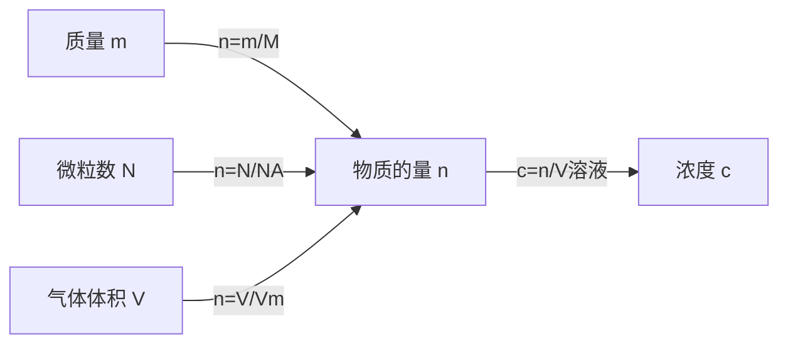

# 第 5 章：物质的量

- **难度**：★★☆ | **预估学时**：1.2 小时 | **前置**：第 4 章

## 学习目标
学完本章，你能：
1. 在质量、粒子数、气体体积、浓度之间换算；
2. 正确使用 n = m/M、n = N/N_A、n = V/V_m、c = n/V；
3. 分清"标况"和"常温常压"。

## 一句话核心
摩尔是把"数不清的微粒"换成"可以称量的份数"的桥梁：1 mol 就是 6.02×10²³ 个微粒。

## 零基础讲解

### 概念 1：摩尔与阿伏伽德罗常数（难度：基础）

**物质的量**（符号 n）是一个物理量，单位是**摩尔**（mol）。1 mol 任何微粒都含 6.02×10²³ 个该微粒，这个数叫**阿伏伽德罗常数** N_A。

为什么用这么大一个数？因为一滴水里就有约 1.7×10²¹ 个水分子，直接用"个"计数不现实。用 mol 就像用"打"计数鸡蛋：一打是 12 个，一摩尔是 6.02×10²³ 个。

注意，mol 后面要说明是什么微粒：1 mol H 是 6.02×10²³ 个氢原子，1 mol H₂ 是 6.02×10²³ 个氢分子，两者质量差一倍。

### 概念 2：摩尔质量（难度：基础）

**摩尔质量** M 是 1 mol 物质的质量，单位 g/mol。数值上等于该物质的相对分子质量（或相对原子质量）。

- H₂O 的相对分子质量是 18，所以 M(H₂O) = 18 g/mol，1 mol 水重 18 g。
- Fe 的相对原子质量是 56，M(Fe) = 56 g/mol。

公式：n = m / M。18 g 水就是 1 mol；36 g 水就是 2 mol。

### 概念 3：气体摩尔体积（难度：基础）

在**标准状况**（0 ℃、101 kPa）下，1 mol 任何理想气体的体积约为 22.4 L，记作 V_m = 22.4 L/mol。

只有气体能用这个数。水在标况下是液体，1 mol 水约 18 mL，不是 22.4 L。温度升高或压强改变，气体体积也会变，所以"22.4 L/mol"必须绑定"标准状况"。

公式：n = V / V_m（气体，标况）。

### 概念 4：物质的量浓度（难度：进阶）

**浓度** c 表示每升溶液里含多少摩尔溶质，单位 mol/L。公式 c = n / V，V 是**溶液体积**，不是溶剂体积。

配制 0.5 mol/L 的 NaCl 溶液 500 mL：需要 NaCl 的物质的量 n = cV = 0.5 × 0.5 = 0.25 mol，质量 m = nM = 0.25 × 58.5 = 14.6 g。称 14.6 g NaCl，加水溶解并定容到 500 mL。

## 图示

看图说明：中心是 n。质量、微粒数、气体体积都能先换成 n，再由 n 换到浓度。所有换算都绕不开摩尔。

## 类比与实例

类比：mol 像"箱"。一箱鸡蛋 360 个，一箱啤酒 24 瓶，一摩尔任何微粒都是 6.02×10²³ 个。箱子的好处是让"个数"变成"箱数"，可以直接称重、算钱。这个类比在"微粒种类不同、单箱质量不同"时正好成立：1 mol H₂ 和 1 mol O₂ 都是 6.02×10²³ 个分子，但质量不同。

实例：标况下 11.2 L CO₂ 有多少摩尔、多少克、多少个分子？
n = 11.2 / 22.4 = 0.5 mol；m = 0.5 × 44 = 22 g；分子数 = 0.5 × 6.02×10²³ = 3.01×10²³ 个。

## 常见误解
- 别以为"1 mol 任何物质都是 22.4 L"——22.4 L/mol 只对气体、只在标况成立。
- 别以为"摩尔质量就是相对分子质量"——数值相等，但摩尔质量有单位 g/mol。
- 别以为"浓度公式里的 V 是水的体积"——是溶液总体积，定容后的体积。

## 自测题（答案）
1. 2 mol H₂SO₄ 的质量是多少？（M = 98 g/mol）
（答案：196 g；解析：m = nM = 2×98。）

2. 标况下 4.48 L O₂ 的物质的量是多少？
（答案：0.2 mol；解析：n = 4.48/22.4。）

3. 将 0.1 mol NaCl 溶于水配成 200 mL 溶液，浓度是多少？
（答案：0.5 mol/L；解析：c = n/V = 0.1/0.2。）

## 复习锚点
- n 是中心，四条换算公式围着它转。
- 22.4 L/mol 的两个前提：气体、标准状况。
- 浓度分母是溶液体积，不是溶剂体积。
