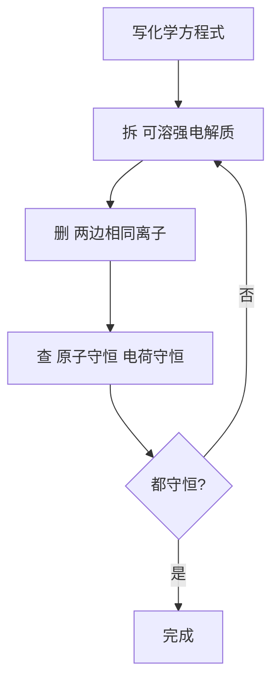

# 第 6 章：电解质与离子反应

- **难度**：★★☆ | **预估学时**：1.2 小时 | **前置**：第 4、5 章

## 学习目标
学完本章，你能：
1. 判断一种物质是不是电解质、是强电解质还是弱电解质；
2. 写出电离方程式；
3. 按"写、拆、删、查"四步写出正确的离子方程式。

## 一句话核心
离子方程式只留下真正参加反应的离子，把" spectator ion "（旁观离子）删掉，但难溶物、气体、弱电解质不能拆。

## 零基础讲解

### 概念 1：电解质与非电解质（难度：基础）

在水溶液里或熔融状态下能导电的**化合物**叫**电解质**，如 NaCl、HCl、NaOH。两者都不能导电的化合物叫**非电解质**，如蔗糖、乙醇。

注意两个坑：铜丝能导电，但它是单质，不是电解质；NaCl 固体不导电，但它在水溶液里能导电，所以 NaCl 是电解质。电解质是"化合物"这个身份，不是"能不能导电"这个现象。

### 概念 2：强电解质与弱电解质（难度：基础）

**强电解质**在水中完全电离：强酸（HCl、H₂SO₄、HNO₃）、强碱（NaOH、KOH、Ba(OH)₂）、绝大多数盐。
**弱电解质**只部分电离：弱酸（CH₃COOH、H₂CO₃、HClO）、弱碱（NH₃·H₂O）、水。

电离方程式写法不同：
- 强电解质：NaCl → Na⁺ + Cl⁻；H₂SO₄ → 2H⁺ + SO₄²⁻
- 弱电解质：CH₃COOH ⇌ CH₃COO⁻ + H⁺（用可逆号）
- 多元弱酸分步写：H₂CO₃ ⇌ H⁺ + HCO₃⁻，HCO₃⁻ ⇌ H⁺ + CO₃²⁻

### 概念 3：离子方程式（难度：进阶）

离子方程式表示同一类反应的共同本质。以盐酸与氢氧化钠为例：
HCl + NaOH → NaCl + H₂O
拆成离子：H⁺ + Cl⁻ + Na⁺ + OH⁻ → Na⁺ + Cl⁻ + H₂O
删掉两边相同的 Na⁺、Cl⁻：H⁺ + OH⁻ → H₂O

四步口诀：**写**（写化学方程式）、**拆**（把可溶性强电解质拆成离子）、**删**（删两边相同的离子）、**查**（查原子守恒和电荷守恒）。

拆的规则要背：
- 可溶的强电解质拆成离子；
- 难溶物（CaCO₃、BaSO₄、AgCl）、气体（CO₂、H₂）、水、弱电解质、氧化物（Fe₂O₃、CuO）一律不拆，写化学式；
- 微溶物作反应物时，若澄清溶液则拆，若悬浊液则不拆。

### 概念 4：复分解反应发生的条件（难度：基础）

两种化合物互相交换成分，生成沉淀、气体或水，反应才能进行。三者只要有一个就行。
- 生成沉淀：AgNO₃ + NaCl → AgCl↓ + NaNO₃
- 生成气体：Na₂CO₃ + 2HCl → 2NaCl + H₂O + CO₂↑
- 生成水：HCl + NaOH → NaCl + H₂O

## 图示

看图说明：四步是一个循环，查不过就回去重拆。"拆"是最容易出错的一步，重点记哪些不能拆。

## 类比与实例

类比：离子方程式像开会签到。真正参与决策的人留下（参加反应的离子），只是坐在旁边的人删掉（旁观离子）。但"难溶物"是没到场的关键人物，不能删。

实例：碳酸钙与盐酸反应。
化学方程式：CaCO₃ + 2HCl → CaCl₂ + H₂O + CO₂↑
拆：CaCO₃ 难溶不拆；HCl 拆成 H⁺ + Cl⁻；CaCl₂ 拆成 Ca²⁺ + 2Cl⁻。
删：两边 Cl⁻ 删掉。
结果：CaCO₃ + 2H⁺ → Ca²⁺ + H₂O + CO₂↑
检查：Ca 1=1，C 1=1，O 3=1+2，H 2=2，电荷左边 +2、右边 +2。

## 常见误解
- 别以为"能导电的就是电解质"——铜能导电但是单质，不是电解质。
- 别以为"离子方程式两边离子数目可以随便删"——只有两边完全相同的离子才能删，而且要保证电荷守恒。
- 别以为"弱酸可以拆成 H⁺"——弱酸是弱电解质，必须写化学式。

## 自测题（答案）
1. 下列物质属于强电解质的是（ ）。A. CH₃COOH B. NH₃·H₂O C. NaCl D. 蔗糖
（答案：C；解析：NaCl 是盐，完全电离。A、B 是弱电解质，D 是非电解质。）

2. 写出盐酸与氢氧化钾反应的离子方程式。
（答案：H⁺ + OH⁻ → H₂O；解析：K⁺、Cl⁻ 是旁观离子，删掉。）

3. 判断："CaCO₃ 与盐酸反应的离子方程式中，CaCO₃ 应拆成 Ca²⁺ 和 CO₃²⁻。"
（答案：不对。CaCO₃ 难溶，不能拆，写化学式。）

## 复习锚点
- 电解质必须是化合物，强弱看电离程度。
- 离子方程式四步：写、拆、删、查。
- 难溶物、气体、水、弱电解质、氧化物不拆。
