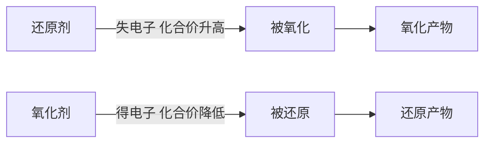

# 第 7 章：氧化还原反应

- **难度**：★★★ | **预估学时**：1.5 小时 | **前置**：第 3、6 章

## 学习目标
学完本章，你能：
1. 用化合价升降判断一个反应是不是氧化还原反应；
2. 指出氧化剂、还原剂、被氧化、被还原；
3. 用电子守恒配平简单的氧化还原方程式。

## 一句话核心
氧化还原的本质是电子转移：**升失氧、降得还**——化合价升高、失电子、被氧化；化合价降低、得电子、被还原。

## 零基础讲解

### 概念 1：从化合价看氧化还原（难度：基础）

有元素化合价升降的反应就是**氧化还原反应**。锌与硫酸反应：
Zn + H₂SO₄ → ZnSO₄ + H₂↑
Zn 从 0 升到 +2，H 从 +1 降到 0。有升有降，是氧化还原。

四大基本反应里，置换反应一定是氧化还原；复分解一定不是；化合和分解要看有没有单质参加或生成。比如 2H₂O₂ → 2H₂O + O₂↑ 是分解反应，但 O 从 −1 变到 −2 和 0，是氧化还原。

### 概念 2：氧化剂与还原剂（难度：基础）

- **还原剂**：失电子、化合价升高、被氧化，产物是氧化产物。
- **氧化剂**：得电子、化合价降低、被还原，产物是还原产物。

记法："剂"字看对方。还原剂帮别人还原，自己被氧化。

常见氧化剂：O₂、Cl₂、浓硫酸、HNO₃、KMnO₄、FeCl₃、H₂O₂。
常见还原剂：金属单质、H₂、C、CO、SO₂、KI、FeSO₄。

### 概念 3：电子转移的表示（难度：进阶）

两种画法：
- **双线桥**：从反应物指向生成物，标"得/失 n e⁻"，箭头上写化合价变化。
- **单线桥**：只在反应物之间画，从还原剂指向氧化剂，标转移电子总数。

双线桥适合练习，单线桥适合快速判断。无论哪种，得失电子总数必须相等，这是配平的依据。

### 概念 4：氧化还原配平（难度：高难）

步骤：标价 → 找升降 → 算电子 → 配系数 → 补 H₂O/H⁺/OH⁻ → 查守恒。

例：KMnO₄ 与 FeSO₄ 在酸性条件下反应。
Mn：+7 → +2，得 5 e⁻
Fe：+2 → +3，失 1 e⁻
电子守恒要求 Mn : Fe = 1 : 5。
2KMnO₄ 里的 Mn 是 2 个，所以 FeSO₄ 要 10 个？先写成 2KMnO₄ + 10FeSO₄，再补硫酸和产物：
2KMnO₄ + 10FeSO₄ + 8H₂SO₄ → K₂SO₄ + 2MnSO₄ + 5Fe₂(SO₄)₃ + 8H₂O
检查：K 2=2，Mn 2=2，Fe 10=10，S 左边 10+8=18，右边 1+2+15=18，H 16=16，O 左边 8+40+32=80，右边 4+8+60+8=80。配平。

## 图示

看图说明：左边是反应物，右边是产物。箭头方向表示电子流向：还原剂把电子给氧化剂。

## 类比与实例

类比：氧化还原像转账。还原剂是付款方，余额减少（化合价升高），对方账户增加；氧化剂是收款方。电子就是钱，总量不变。这个类比在"电子对偏移"的共价反应里要打折扣，因为电子并没有完全转手。

实例：判断 2Na + Cl₂ → 2NaCl 中的角色。
Na：0 → +1，失电子，是还原剂，被氧化。
Cl：0 → −1，得电子，是氧化剂，被还原。
转移电子数：2 个 Na 各失 1 个，共 2 e⁻。

## 常见误解
- 别以为"氧化剂被氧化"——氧化剂被还原，还原剂被氧化。
- 别以为"有氧元素参加就是氧化还原"——CO₂ + H₂O → H₂CO₃ 没有化合价变化，不是氧化还原。
- 别以为"化合价升高就是得电子"——升高是失电子，记"升失氧"。

## 自测题（答案）
1. 下列反应属于氧化还原反应的是（ ）。A. NaOH + HCl → NaCl + H₂O B. CaCO₃ → CaO + CO₂↑ C. Zn + CuSO₄ → ZnSO₄ + Cu D. CO₂ + Ca(OH)₂ → CaCO₃↓ + H₂O
（答案：C；解析：Zn 0→+2，Cu +2→0，有化合价变化。）

2. 在反应 Fe + 2HCl → FeCl₂ + H₂↑ 中，氧化剂是（ ）。
（答案：HCl（其中的 H⁺）；解析：H 从 +1 降到 0，得电子。）

3. 配平：__KMnO₄ + __HCl → __KCl + __MnCl₂ + __Cl₂↑ + __H₂O
（答案：2KMnO₄ + 16HCl → 2KCl + 2MnCl₂ + 5Cl₂↑ + 8H₂O；解析：Mn 得 5 e⁻，每个 Cl 失 1 e⁻，Cl₂ 失 2 e⁻，Mn 与 Cl₂ 系数比 2:5。）

## 复习锚点
- 升失氧、降得还；剂性相反。
- 配平先电子守恒，再原子守恒。
- 置换反应必是氧化还原，复分解一定不是。
