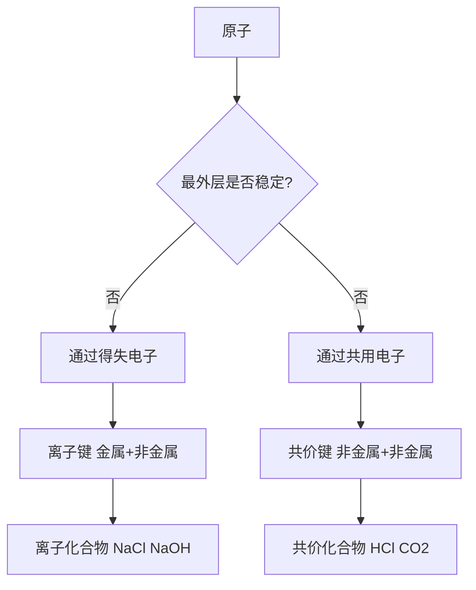

# 第 8 章：元素周期表与化学键

- **难度**：★★☆ | **预估学时**：1.2 小时 | **前置**：第 2、7 章

## 学习目标
学完本章，你能：
1. 由原子序数说出元素在周期表的位置；
2. 判断金属性、非金属性强弱；
3. 区分离子键、共价键，判断化合物类型。

## 一句话核心
周期表按**电子层数**分行、按**最外层电子数**分列；原子靠"凑成稳定电子结构"的动机结合成键。

## 零基础讲解

### 概念 1：周期与族（难度：基础）

**周期**是横向的行，第 n 周期对应原子的 n 个电子层。第 1 周期只有 H、He；第 2 周期有 8 种元素；第 3 周期 8 种。
**族**是纵向的列，主族用 A 表示，副族用 B。主族序数 = 最外层电子数（对主族元素成立）。第 ⅠA 族最外层 1 个电子，第 ⅦA 族 7 个。

周期表可以按"金属/非金属"分界线记：硼、硅、砷、碲、砹附近是分界线，左下方是金属，右上方是非金属，稀有气体在最右列。

### 概念 2：元素性质的周期性（难度：进阶）

同周期从左到右：核电荷数增大，原子半径减小，金属性减弱、非金属性增强。
同主族从上到下：电子层增多，原子半径增大，金属性增强、非金属性减弱。

判断金属性强弱的实用依据：单质与水或酸反应越剧烈，金属性越强；最高价氧化物对应水化物（氢氧化物）碱性越强，金属性越强。
判断非金属性：单质与氢气化合越容易、生成氢化物越稳定，非金属性越强；最高价含氧酸酸性越强，非金属性越强。

### 概念 3：离子键（难度：基础）

**离子键**是阴、阳离子之间的静电作用。典型组合是活泼金属 + 活泼非金属，如 NaCl、MgO、KBr。

形成过程：Na 失 1 个电子变 Na⁺，Cl 得 1 个电子变 Cl⁻，两者靠静电引力结合。离子键没有方向性、没有饱和性，所以 NaCl 晶体里每个 Na⁺ 周围有 6 个 Cl⁻。

### 概念 4：共价键（难度：进阶）

**共价键**是原子间共用电子对形成的键。非金属原子之间常形成共价键，如 H₂、Cl₂、H₂O、CO₂、CH₄。

共价键分极性键和非极性键：
- 同种原子之间，电子对不偏移，是非极性键（H—H、Cl—Cl）；
- 不同种原子之间，电子对偏向电负性大的原子，是极性键（H—Cl、O—H）。

判断化合物类型：含离子键的化合物是离子化合物（NaCl、NaOH、Na₂O₂）；只含共价键的是共价化合物（HCl、CO₂、CH₄）。注意 NaOH 里既有离子键（Na⁺ 与 OH⁻）又有共价键（O—H），仍归为离子化合物。

### 概念 5：分子间作用力与氢键（难度：进阶）

分子之间还有较弱的作用力，叫**范德华力**，它决定物质的熔沸点。**氢键**是更特殊的一种：H 与电负性强的 N、O、F 相连时形成，比范德华力强、比共价键弱。

水、NH₃、HF 的沸点异常高，就是氢键造成的。冰能浮在水面上，也和氢键形成的空腔结构有关。

## 图示

看图说明：稳定结构是目标，"得电子/失电子"与"共用电子"是两条路径，对应两类键。

## 类比与实例

类比：离子键像磁铁吸铁钉，正负相吸，没有方向；共价键像两人共握一根绳子，必须靠近、有方向。这个类比在金属键处失效，金属键是"电子海"把金属阳离子黏在一起。

实例：判断 Na₂O、HCl、NaOH、CO₂ 的键型。
Na₂O：离子键；HCl：极性共价键；NaOH：离子键 + 极性共价键；CO₂：极性共价键（C=O），但分子整体对称，是非极性分子。

## 常见误解
- 别以为"有共价键的化合物就是共价化合物"——NaOH 有共价键，但它是离子化合物。
- 别以为"稀有气体最外层都是 8 个电子"——He 只有 2 个。
- 别以为"分子间作用力和化学键是一回事"——化学键改变物质种类，分子间作用力只影响熔沸点。

## 自测题（答案）
1. 下列化合物中只含共价键的是（ ）。A. NaCl B. NaOH C. CO₂ D. K₂O
（答案：C；解析：CO₂ 由 C、O 非金属原子通过共价键结合。）

2. 比较 Na、Mg、Al 的金属性强弱。
（答案：Na > Mg > Al；解析：同周期从左到右金属性减弱。）

3. 判断："H₂O 的沸点比 H₂S 高，是因为 H₂O 分子间的氢键。"这句话对吗？
（答案：对。O 的电负性大、半径小，水分子间能形成氢键，H₂S 不能。）

## 复习锚点
- 周期看电子层数，主族看最外层电子数。
- 同周期右上方非金属性强，左下方金属性强。
- 离子键无方向性，共价键有方向性；NaOH 是离子化合物。
