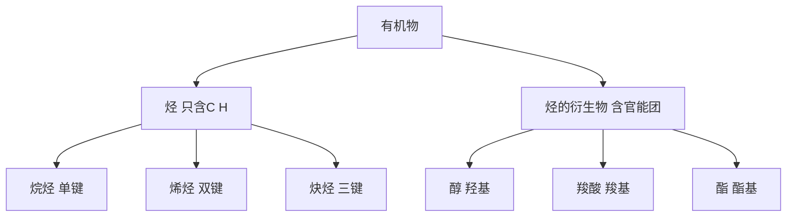

# 第 10 章：有机化学初识

- **难度**：★★☆ | **预估学时**：1 小时 | **前置**：第 8 章

## 学习目标
学完本章，你能：
1. 判断一个化合物是不是有机物；
2. 认出羟基、羧基、碳碳双键、酯基四种官能团；
3. 区分取代反应和加成反应。

## 一句话核心
有机化学研究含碳化合物，碳原子能形成四个共价键，靠官能团决定性质。

## 零基础讲解

### 概念 1：什么是有机物（难度：基础）

**有机物**是绝大多数含碳的化合物，但 CO、CO₂、碳酸、碳酸盐、氰化物等归为无机物。有机物主要由 C、H 组成，常含 O、N、S、P、卤素。

有机物数量庞大，原因是碳原子能彼此成链、成环，还能接各种官能团。目前已知有机物超过一亿种，而无机物只有几十万种。

### 概念 2：烃与官能团（难度：基础）

只含 C、H 两种元素的有机物叫**烃**。
- **烷烃**：只含单键，饱和，如 CH₄、C₂H₆。
- **烯烃**：含碳碳双键 C=C，如 CH₂=CH₂。
- **炔烃**：含碳碳三键 C≡C，如 HC≡CH。

**官能团**是决定有机物化学性质的原子或原子团。必须认识的四个：
- 羟基 —OH（醇、酚）
- 羧基 —COOH（羧酸）
- 碳碳双键 C=C（烯烃）
- 酯基 —COO—（酯）

### 概念 3：同分异构（难度：进阶）

分子式相同、结构不同的化合物互为**同分异构体**。比如 C₄H₁₀ 有两种：正丁烷 CH₃CH₂CH₂CH₃ 和异丁烷 CH₃CH(CH₃)CH₃。它们分子式都是 C₄H₁₀，但支链不同，性质不同。

同分异构有三种常见类型：碳链异构（支链位置不同）、位置异构（官能团位置不同）、类别异构（官能团种类不同，如乙醇和二甲醚）。

### 概念 4：取代与加成（难度：进阶）

**取代反应**：有机物中的原子或原子团被其他原子或原子团替换。
CH₄ + Cl₂ →(光照) CH₃Cl + HCl

**加成反应**：不饱和键打开，两个原子或基团直接加上去。
CH₂=CH₂ + Br₂ → CH₂BrCH₂Br

**酯化反应**：羧酸和醇在浓硫酸催化下生成酯和水，属于取代反应的一种。
CH₃COOH + C₂H₅OH ⇌(浓硫酸, △) CH₃COOC₂H₅ + H₂O

## 图示

看图说明：先分"只含 C、H"还是"含官能团"，再按官能团细分类。这张图是后面有机模块的骨架。

## 类比与实例

类比：碳原子像有四个插口的海绵，能接四个键；官能团像插在不同位置的"功能模块"，插上什么模块，就有什么性质。这个类比在"共轭体系"里会失效，因为双键之间会相互影响，不是简单拼接。

实例：乙醇 C₂H₅OH 和二甲醚 CH₃OCH₃ 分子式都是 C₂H₆O，但乙醇有羟基、能与钠反应，二甲醚没有羟基、不能。这就是类别异构导致性质不同。

## 常见误解
- 别以为"含碳的化合物都是有机物"——CO₂、Na₂CO₃ 是无机物。
- 别以为"同分异构体是同一种物质"——结构不同，性质不同，是不同物质。
- 别以为"加成反应和取代反应可以随便叫"——加成是不饱和键打开加东西，取代是换掉一个原子或基团。

## 自测题（答案）
1. 下列属于有机物的是（ ）。A. CO₂ B. CH₄ C. Na₂CO₃ D. H₂CO₃
（答案：B；解析：CH₄ 是含碳的烃。）

2. 乙烯与溴水反应属于（ ）。A. 取代反应 B. 加成反应 C. 酯化反应 D. 复分解反应
（答案：B；解析：碳碳双键打开，溴原子加在两个碳上。）

3. 写出乙酸与乙醇酯化反应的化学方程式。
（答案：CH₃COOH + C₂H₅OH ⇌ CH₃COOC₂H₅ + H₂O，条件为浓硫酸、加热。）

## 复习锚点
- 有机物看碳，但 CO₂、碳酸盐除外。
- 四个必认官能团：羟基、羧基、碳碳双键、酯基。
- 取代是"换"，加成是"加"，酯化是取代的一种。
