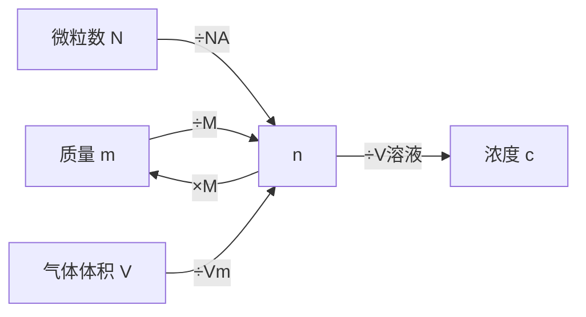

# 物质的量

- **难度**：进阶 | **涉及章节**：第 5 章

## 一句话定义
物质的量是表示"微粒集合有多少份"的物理量，1 份就是 1 mol，含 6.02×10²³ 个微粒。

## 为什么重要
它是化学计算的通用货币。质量、气体体积、溶液浓度、微粒数，四种完全不同的量，都要先换成物质的量才能互相比较。没有它，方程式里的系数就只是"个数比"，没法称、没法量。

## 图示

## 详解

摩尔不是质量单位，也不是体积单位，它数的是"个数"。一打鸡蛋是 12 个，一摩尔微粒是 6.02×10²³ 个。选这么大的数，是因为微观粒子实在太多：1 g 水中约有 3.3×10²² 个水分子。

四条换算都以 n 为中心。做题时先把题目给的量换成 n，再从 n 换成目标量。这个习惯能避免"公式记混"：公式可以忘，中心思想不会忘。

摩尔质量 M 的单位是 g/mol，数值上等于相对分子质量。气体摩尔体积 22.4 L/mol 只对气体、只在标准状况成立。浓度 c = n/V，V 是溶液体积。

## 常见误解
- 别以为"1 mol 任何物质都是 22.4 L"——只对气体、只在标况。
- 别以为"摩尔质量没有单位"——数值等于相对分子质量，但单位是 g/mol。
- 别以为"浓度公式里的 V 是溶剂体积"——是溶液总体积。

## 在书中出现的脉络
| 章节 | 语境 | 关键结论 |
|---|---|---|
| 入门第 5 章 | 四条换算 | n 是中心 |
| 普化第 1 章 | 理想气体方程 | pV=nRT 把 n 与 p、V、T 连起来 |
| 普化第 6 章 | 浓度与 pH | c 是平衡计算的起点 |

## 相关概念
- 前置：化学式、化学方程式
- 后续：理想气体、化学平衡、浓度
