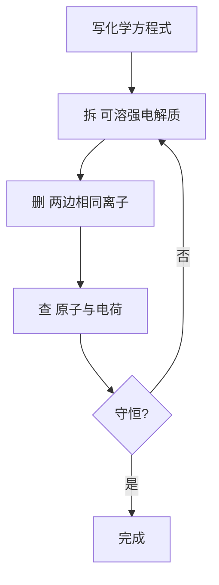

# 离子方程式

- **难度**：进阶 | **涉及章节**：入门第 6 章、陌生方程式第 1 章

## 一句话定义
离子方程式是把可溶强电解质拆成离子、删去两边旁观离子后，只保留真正参加反应的离子的方程式。

## 为什么重要
它表示一类反应的共同本质。盐酸与氢氧化钠、硫酸与氢氧化钾，化学方程式不同，离子方程式都是 H⁺ + OH⁻ → H₂O。掌握了它，就不必为每个具体物质单独背反应。

## 图示

## 详解

拆写规则是核心。能拆的只有"可溶的强电解质"：强酸、强碱、可溶性盐。不能拆的包括：
- 难溶物：CaCO₃、BaSO₄、AgCl、Fe(OH)₃；
- 气体：CO₂、SO₂、H₂；
- 水；
- 弱电解质：CH₃COOH、NH₃·H₂O、HClO；
- 氧化物：Fe₂O₃、CuO。

微溶物要看状态：澄清石灰水作反应物时拆成 Ca²⁺ 和 OH⁻，石灰乳则不拆。

检查两项：原子守恒、电荷守恒。电荷不平，说明拆错或系数错，必须回去改。

## 常见误解
- 别以为"所有化合物都要拆"——难溶物、气体、水、弱电解质、氧化物都不拆。
- 别以为"两边相同的离子都可以删"——只有完全相同的离子才能删，且删后要保证电荷守恒。
- 别以为"弱酸写成 H⁺ 更简洁"——弱酸是弱电解质，必须写化学式。

## 在书中出现的脉络
| 章节 | 语境 | 关键结论 |
|---|---|---|
| 入门第 6 章 | 四步法 | 写、拆、删、查 |
| 普化第 6 章 | 酸碱反应 | H⁺ + OH⁻ → H₂O |
| 陌生第 1 章 | 信息型题目 | 先定产物再拆写 |

## 相关概念
- 前置：电解质、电离
- 后续：酸碱平衡、沉淀溶解平衡
