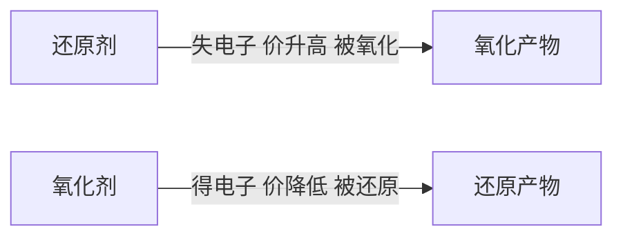

# 氧化还原反应

- **难度**：高难 | **涉及章节**：入门第 7 章、普化第 8 章、陌生第 1 章

## 一句话定义
有元素化合价升降（电子转移）的化学反应，叫氧化还原反应。

## 为什么重要
它是一大类反应的统一框架：金属腐蚀、电池、燃烧、呼吸、工业制氯、炼铁，全是氧化还原。判断氧化剂还原剂、配平、写电极反应，都从这一条出发。

## 图示

## 详解

判断只看一件事：有没有元素化合价变化。有，就是氧化还原；没有，就不是。不要看有没有氧元素参加。

四个角色要分清：
- 还原剂：失电子、价升高、被氧化；
- 氧化剂：得电子、价降低、被还原；
- 氧化产物：还原剂被氧化后的产物；
- 还原产物：氧化剂被还原后的产物。

配平的核心是电子守恒。算出每个元素得失多少电子，让总数相等，再配原子，最后补 H⁺/OH⁻/H₂O。离子方程式还要查电荷。

## 常见误解
- 别以为"氧化剂被氧化"——氧化剂被还原，还原剂被氧化。
- 别以为"有氧气参加就是氧化还原"——要看化合价有没有变。
- 别以为"配平只数原子"——氧化还原必须先让电子守恒。

## 在书中出现的脉络
| 章节 | 语境 | 关键结论 |
|---|---|---|
| 入门第 7 章 | 四大反应类型 | 置换必是，复分解必不是 |
| 普化第 8 章 | 原电池 | 负极氧化、正极还原 |
| 陌生第 1 章 | 信息型配平 | 电子守恒优先 |

## 相关概念
- 前置：化合价、化学方程式
- 后续：电极电势、Nernst 方程
