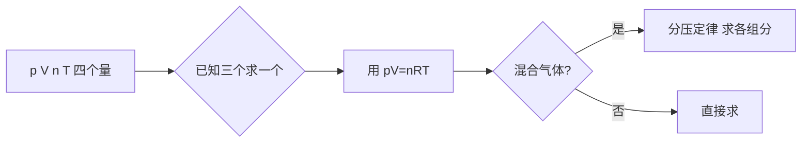

# 第 1 章：气体

- **难度**：★★☆ | **预估学时**：1 小时 | **前置**：入门篇第 5 章（物质的量）

## 学习目标
学完本章，你能：
1. 用 $pV=nRT$ 算压强、体积、温度、物质的量中的任意一个；
2. 用分压定律处理混合气体；
3. 说出实际气体偏离理想气体的原因。

## 一句话核心
理想气体把分子当成"没有体积、彼此不吸引"的质点，$pV=nRT$ 就是这种假设下的状态方程。

## 零基础讲解

### 概念 1：理想气体状态方程（难度：基础）

$$pV = nRT$$

p 是压强（Pa），V 是体积（m³），n 是物质的量（mol），T 是热力学温度（K），R 是气体常数 8.314 J/(mol·K)。

用这个方程必须用热力学温度：$T = t + 273.15$。0 ℃ 就是 273.15 K。用摄氏度直接代入会算错。

变形可以求密度：$pM = \rho RT$，其中 M 是摩尔质量，ρ 是密度。这个式子常用来由密度反推气体摩尔质量。

### 概念 2：分压定律（难度：进阶）

混合气体中，某组分气体的**分压**等于它单独占据整个容器时产生的压强。Dalton 分压定律：

$$p_{\text{总}} = p_1 + p_2 + \cdots$$

且 $p_i = x_i p_{\text{总}}$，$x_i$ 是摩尔分数。排水集气法收集的气体里混有水蒸气，计算时要先减去饱和水蒸气压：$p_{\text{干气}} = p_{\text{总}} - p_{\text{水}}$。

### 概念 3：分子速率分布（难度：进阶）

气体分子速率并不相同，服从 Maxwell 分布。温度升高，分布曲线变宽、峰值右移，说明高速分子比例增加。

三个统计速率：最概然速率、平均速率、方均根速率。它们都和 $\sqrt{T/M}$ 成正比：温度越高、摩尔质量越小，分子跑得越快。这解释了为什么氢气比氧气扩散快。

### 概念 4：实际气体（难度：进阶）

理想气体假设分子不占体积、没有相互作用。真实气体在高压、低温下分子靠得近，这两条假设失效，实际压强会比理想值低（分子间有引力），体积会比理想值大（分子有体积）。

van der Waals 方程做了修正：

$$\left(p + \frac{a n^2}{V^2}\right)(V - nb) = nRT$$

a 修正分子间引力，b 修正分子体积。a、b 越大，这种气体越"不理想"。

## 图示

看图说明：先判断是不是混合气体，单一气体直接套方程，混合气体先拆组分再求和。

## 类比与实例

类比：理想气体像高峰期的地铁乘客，假设每个人没有体积、互不碰撞，只按平均速度流动。真实气体像带着行李箱的乘客，人与人之间有距离、有摩擦，高压时这些因素就显出来了。

实例：25 ℃、100 kPa 下，2.0 mol N₂ 占多大体积？
T = 298.15 K，V = nRT/p = 2.0 × 8.314 × 298.15 / 100000 = 0.0496 m³ = 49.6 L。

## 常见误解
- 别以为"温度可以直接用摄氏度代入"——必须换成 K。
- 别以为"分压是气体真实存在的压强"——分压是组分单独占容器时的等效压强，总压才是容器承受的压强。
- 别以为"实际气体方程可以随便替代理想气体方程"——低压高温时理想气体已经够准，van der Waals 主要用于高压低温。

## 自测题（答案）
1. 标况下 1 mol 理想气体的体积约为多少？
（答案：22.4 L；解析：V = nRT/p = 1×8.314×273.15/101325 ≈ 0.0224 m³。）

2. 容器中有 0.2 mol O₂ 和 0.8 mol N₂，总压 100 kPa，O₂ 的分压是多少？
（答案：20 kPa；解析：摩尔分数 0.2，分压 = 0.2×100。）

3. 判断："温度升高，气体分子平均速率增大，所以所有分子速率都增大。"
（答案：不对。分布曲线整体右移，但仍有慢分子，是统计上的平均速率增大。）

## 复习锚点
- $pV=nRT$ 四个量、一个常数，单位要统一。
- 分压 = 摩尔分数 × 总压。
- 高压低温时理想气体模型失效，用 van der Waals 修正。
