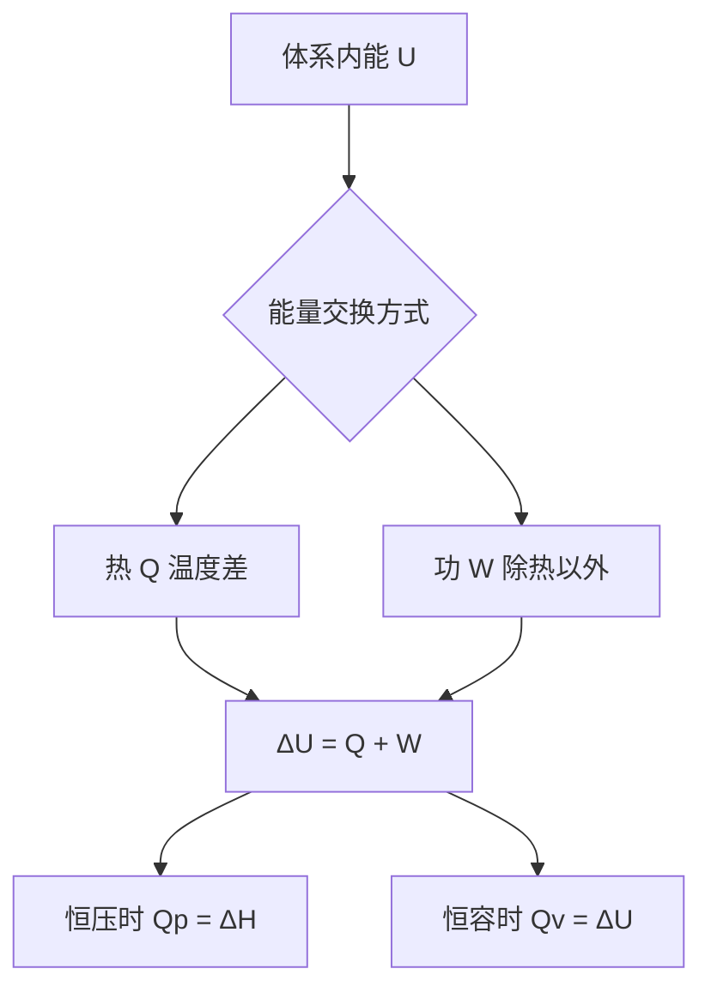

# 第 2 章：热力学第一定律与焓

- **难度**：★★★ | **预估学时**：1.5 小时 | **前置**：第 1 章

## 学习目标
学完本章，你能：
1. 区分体系与环境、状态函数与过程量；
2. 用 $\Delta U = Q + W$ 算内能变化；
3. 说清焓 H 是怎么来的，为什么恒压热等于 ΔH。

## 一句话核心
能量守恒：体系内能的改变，等于它吸收的热加上外界对它做的功。

## 零基础讲解

### 概念 1：体系、环境、状态函数（难度：基础）

被研究的对象叫**体系**，体系之外与之相互作用的部分叫**环境**。体系分三类：敞开体系（能量和物质都能交换）、封闭体系（只交换能量）、孤立体系（都不交换）。

**状态函数**只由体系当前状态决定，与怎么走到这个状态无关：温度 T、压强 p、体积 V、内能 U、焓 H、熵 S、吉布斯自由能 G。**过程量**与路径有关：热 Q、功 W。

状态函数有个重要性质：循环一圈回到起点，变化量为零。所以 $\Delta U$ 只看始末态，不看路径。

### 概念 2：热与功（难度：进阶）

**热 Q** 是因温度差而传递的能量。体系吸热 Q > 0，放热 Q < 0。
**功 W** 是除热以外其他方式传递的能量。本书采用"环境对体系做功为正"的约定，W > 0 表示外界压缩体系、对体系做功。

体积功的计算：$W = -p_{\text{外}}\Delta V$（环境对体系做功）。恒外压膨胀时，体系对外做功，W < 0。

### 概念 3：热力学第一定律（难度：进阶）

$$\Delta U = Q + W$$

内能变化 = 吸收的热 + 外界做的功。这是能量守恒定律在热力学中的表达。

对封闭体系、只做体积功的过程，$W = -p_{\text{外}}\Delta V$，所以 $\Delta U = Q - p_{\text{外}}\Delta V$。

### 概念 4：焓与恒压热（难度：高难）

**焓**定义为 $H = U + pV$。它本身没有直观的物理意义，是一个为了处理恒压过程而构造的量。

恒压过程：$\Delta H = \Delta U + p\Delta V = Q_p - p\Delta V + p\Delta V = Q_p$。

所以恒压下吸收的热等于焓变。这就是为什么热化学方程式里写的反应热，通常就是 ΔH。恒容过程则 $Q_V = \Delta U$。

焓是状态函数，ΔH 只与始末态有关，这为盖斯定律打下基础。

## 图示

看图说明：能量通过热和功两条通道进出体系，第一定律把它们合起来。恒压和恒容分别对应两种常用测量条件。

## 类比与实例

类比：内能像银行卡余额，热是转账收入，功是刷卡消费。余额变化只看进账和出账的总和，不看中间转了几次。这个类比在"体系对外做功"时符号要反过来记：刷卡消费是负的。

实例：1 mol 理想气体在 300 K 恒温可逆膨胀，体积从 1 L 到 2 L。恒温下 ΔU = 0（理想气体内能只与温度有关），所以 Q = −W。体系对外做功，W < 0，Q > 0，吸热。

## 常见误解
- 别以为"焓就是热量"——焓是状态函数，只有在恒压、只做体积功的条件下，ΔH 才等于 Qp。
- 别以为"状态函数和路径无关，所以 Q 和 W 也无关"——Q、W 是过程量，路径不同数值不同。
- 别以为"ΔU = Q + W 里的 W 一定是正的"——看约定，本书环境对体系做功为正。

## 自测题（答案）
1. 下列属于状态函数的是（ ）。A. Q B. W C. H D. 反应热
（答案：C；解析：焓只由状态决定。Q、W 是过程量。）

2. 恒压下某反应放热 50 kJ，则 ΔH 为多少？
（答案：−50 kJ；解析：放热 Qp < 0，ΔH = Qp。）

3. 判断："体系对外做功，内能一定减少。"
（答案：不一定。若同时吸热且吸热量大于做功量，内能反而增加。）

## 复习锚点
- $\Delta U = Q + W$，符号约定先记牢。
- 焓 H = U + pV，恒压热等于 ΔH。
- 状态函数看始末，过程量看路径。
