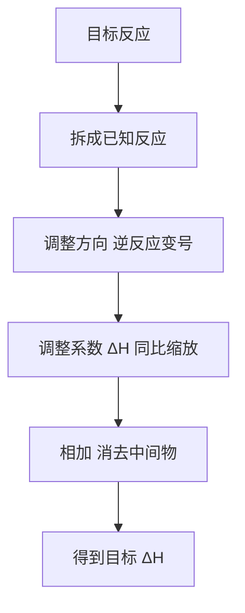

# 第 3 章：热化学与盖斯定律

- **难度**：★★☆ | **预估学时**：1.2 小时 | **前置**：第 2 章

## 学习目标
学完本章，你能：
1. 正确书写热化学方程式（标状态、标 ΔH）；
2. 用盖斯定律算难以直接测量的反应热；
3. 用标准生成焓或键焓估算 ΔH。

## 一句话核心
反应热只由始末态决定，所以可以把几个已知反应像代数式一样相加，得到目标反应的热效应。

## 零基础讲解

### 概念 1：热化学方程式（难度：基础）

热化学方程式比普通方程式多三样东西：物质的状态、化学计量数对应的 ΔH、ΔH 的符号和单位。

$$H_2(g) + \frac{1}{2}O_2(g) \rightarrow H_2O(l) \quad \Delta H = -285.8\ \text{kJ/mol}$$

写法要点：
- 必须标状态：(g) 气、(l) 液、(s) 固、(aq) 水溶液。
- ΔH 写在方程式右边，放热为负、吸热为正。
- 系数表示物质的量，可以是分数；系数翻倍，ΔH 也翻倍。
- 逆反应的 ΔH 与正反应数值相等、符号相反。

### 概念 2：盖斯定律（难度：进阶）

一个反应无论一步完成还是分几步完成，总热效应相同。因为 ΔH 是状态函数，只与始末态有关。

用法：把目标反应拆成几个已知反应，调整系数和方向，让中间产物消掉，ΔH 相应相加。

例：已知
(1) C(s) + O₂(g) → CO₂(g)，ΔH₁ = −393.5 kJ/mol
(2) CO(g) + ½O₂(g) → CO₂(g)，ΔH₂ = −283.0 kJ/mol
求 C(s) + ½O₂(g) → CO(g) 的 ΔH。

目标反应 = (1) − (2)：ΔH = −393.5 − (−283.0) = −110.5 kJ/mol。

### 概念 3：标准生成焓（难度：进阶）

**标准摩尔生成焓** ΔH_f° 是在标准状态（298.15 K、100 kPa）下，由稳定单质生成 1 mol 该物质时的焓变。稳定单质的生成焓规定为零。

反应焓变 = 产物生成焓之和 − 反应物生成焓之和：

$$\Delta H = \sum \nu_i \Delta H_f^\circ(\text{产物}) - \sum \nu_i \Delta H_f^\circ(\text{反应物})$$

注意系数要乘进去，别漏。

### 概念 4：键焓估算（难度：进阶）

**键焓**是断开 1 mol 某化学键所需的能量。反应热约等于断键吸收的能量减去成键放出的能量：

$$\Delta H \approx \sum E_{\text{断}} - \sum E_{\text{成}}$$

键焓是平均值，不同分子里的同种键并不完全相同，所以这是估算，不是精确值。

## 图示

看图说明：盖斯定律本质是"路径可加"。方向反了 ΔH 变号，系数变了 ΔH 按比例变。

## 类比与实例

类比：盖斯定律像换乘地铁。从 A 到 C，可以直达，也可以 A→B→C，票价（能量变化）只与起点终点有关，与换乘几次无关。这个类比在"非状态函数"处失效，比如时间、路程就与路径有关。

实例：用生成焓算甲烷燃烧。
CH₄(g) + 2O₂(g) → CO₂(g) + 2H₂O(l)
ΔH_f°：CH₄ −74.8，CO₂ −393.5，H₂O(l) −285.8，O₂ 0。
ΔH = (−393.5 + 2×−285.8) − (−74.8 + 0) = −890.3 kJ/mol。

## 常见误解
- 别以为"热化学方程式可以不标状态"——状态不同，ΔH 差很多（气态水和液态水差 44 kJ/mol）。
- 别以为"ΔH 为负表示反应不能发生"——负只表示放热，能不能自发还要看熵和吉布斯自由能。
- 别以为"盖斯定律只能用于燃烧反应"——只要始末态确定，任何反应都能用。

## 自测题（答案）
1. 热化学方程式中，ΔH = +58 kJ/mol 表示（ ）。A. 放热 B. 吸热 C. 不吸不放 D. 无法判断
（答案：B；解析：ΔH 为正表示体系吸热。）

2. 已知 N₂ + 3H₂ → 2NH₃，ΔH = −92 kJ/mol。若写成 ½N₂ + 1.5H₂ → NH₃，ΔH 为多少？
（答案：−46 kJ/mol；解析：系数减半，ΔH 也减半。）

3. 判断："石墨和金刚石燃烧的 ΔH 相同，因为都是碳。"
（答案：不对。石墨和金刚石是不同状态，生成焓不同，燃烧热不同。）

## 复习锚点
- 热化学方程式三要素：状态、系数、ΔH。
- 盖斯定律：反应相加，ΔH 相加；逆向变号。
- 生成焓算反应热：产物减反应物，系数别漏。
