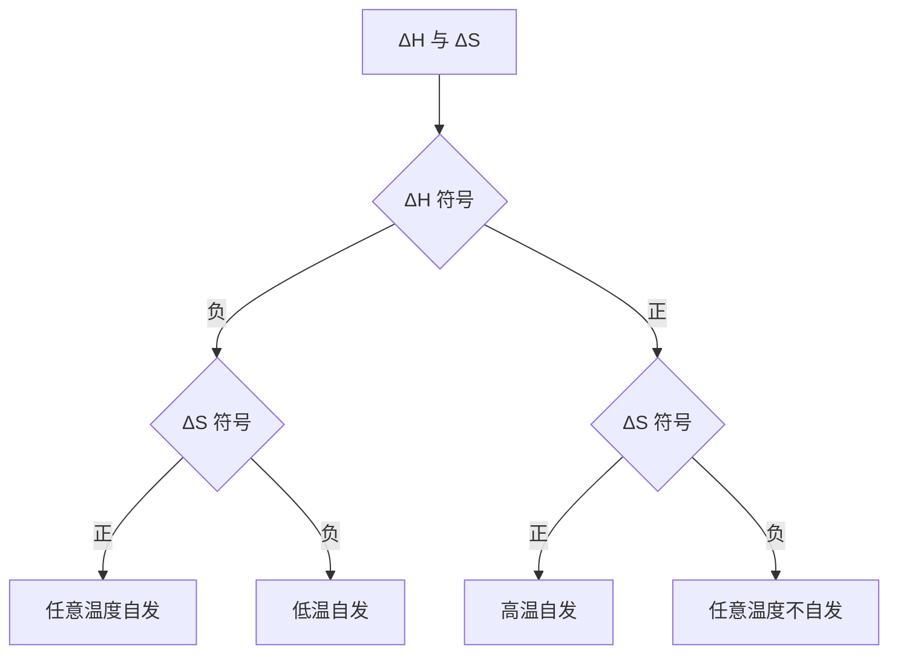

# 第 4 章：熵与吉布斯自由能

- **难度**：★★★ | **预估学时**：1.5 小时 | **前置**：第 2、3 章

## 学习目标
学完本章，你能：
1. 判断一个过程的熵增还是熵减；
2. 用 $\Delta G = \Delta H - T\Delta S$ 判断反应自发方向；
3. 解释"放热反应不一定自发"。

## 一句话核心
自发性由两个因素共同决定：体系趋于最低能量（放热），同时趋于最大混乱度（熵增）；吉布斯自由能把两者合成一个判据。

## 零基础讲解

### 概念 1：熵（难度：进阶）

**熵 S** 是体系混乱度（微观状态数）的量度。熵越大，体系越无序。单位 J/(mol·K)。

经验规律：
- 同一物质：气态熵 > 液态熵 > 固态熵。
- 升温、增大体积、增加物质的量，熵增大。
- 固体溶解、气体分子数增加的反应，通常熵增。

标准摩尔熵 S° 是 1 mol 物质在标准状态下的熵。与生成焓不同，**稳定单质的标准熵不为零**，因为任何物质都有混乱度。

### 概念 2：热力学第二定律（难度：进阶）

孤立体系中，自发过程总是朝着熵增的方向进行：$\Delta S_{\text{总}} \geq 0$。

注意是"总熵"（体系 + 环境），不是只看体系。体系熵减的过程也可能自发，只要环境熵增更多。比如水结冰，体系熵减，但放出的凝固热使环境熵增，总熵仍增。

### 概念 3：吉布斯自由能（难度：高难）

定义 $G = H - TS$。恒温恒压下：

$$\Delta G = \Delta H - T\Delta S$$

判据：$\Delta G < 0$ 自发；$\Delta G = 0$ 平衡；$\Delta G > 0$ 非自发（逆过程自发）。

四种组合要会判断：
- ΔH < 0、ΔS > 0：任何温度都自发。
- ΔH > 0、ΔS < 0：任何温度都不自发。
- ΔH < 0、ΔS < 0：低温自发，高温不自发。
- ΔH > 0、ΔS > 0：高温自发，低温不自发。

转折温度 $T = \Delta H / \Delta S$，此时 ΔG = 0。

### 概念 4：标准吉布斯自由能与平衡常数（难度：高难）

$$\Delta G^\circ = -RT\ln K$$

ΔG° 越负，K 越大，反应进行得越彻底。这条式子把热力学和平衡常数连起来，是第 5 章的基础。

也可以用 $\Delta G^\circ = \Delta G_f^\circ(\text{产物}) - \Delta G_f^\circ(\text{反应物})$ 计算。

## 图示

看图说明：两个符号组合出四种情况，核心是看温度能否让 TΔS 项压过 ΔH 项。

## 类比与实例

类比：ΔG 像一个人的月度收支。ΔH 是固定支出（放热为负，相当于省钱），TΔS 是随气温变化的浮动收入。两项合起来为正还是为负，决定这个月能不能撑下去。这个类比在"ΔG 是状态函数、与路径无关"这一点上要补充说明，收支过程则有路径。

实例：碳酸钙分解 CaCO₃(s) → CaO(s) + CO₂(g)，ΔH = +178 kJ/mol，ΔS = +160 J/(mol·K)。
ΔG = 178 − T×0.160。令 ΔG = 0，T = 1112 K ≈ 839 ℃。所以石灰窑要烧到 900 ℃ 以上。

## 常见误解
- 别以为"放热反应一定自发"——若熵减很大，低温下可能自发，高温下不自发；有些放热反应在特定温度下反而不自发。
- 别以为"ΔG < 0 表示反应很快"——ΔG 只判断方向，不判断速率。速率看活化能。
- 别以为"单质的标准熵为零"——只有生成焓规定为零，熵不为零。

## 自测题（答案）
1. 下列过程熵增的是（ ）。A. 水结冰 B. 气体液化 C. CaCO₃分解产生CO₂ D. 溶液结晶
（答案：C；解析：固体分解出气体，混乱度增大。）

2. 某反应 ΔH = −50 kJ/mol，ΔS = −100 J/(mol·K)，在 298 K 时是否自发？
（答案：自发；解析：先把 ΔS 换成 kJ 单位，−100 J/(mol·K) = −0.100 kJ/(mol·K)。ΔG = −50 − 298×(−0.100) = −50 + 29.8 = −20.2 kJ/mol < 0，所以自发。这里容易错在单位：J 和 kJ 混用会差 1000 倍。）

3. 判断："ΔG° 越负，反应速率越快。"
（答案：不对。ΔG° 只反映热力学趋势，速率由活化能决定。）

## 复习锚点
- 熵看混乱度：气 > 液 > 固。
- ΔG = ΔH − TΔS，四种符号组合决定温度依赖。
- ΔG° = −RT ln K，热力学与平衡的桥梁。
