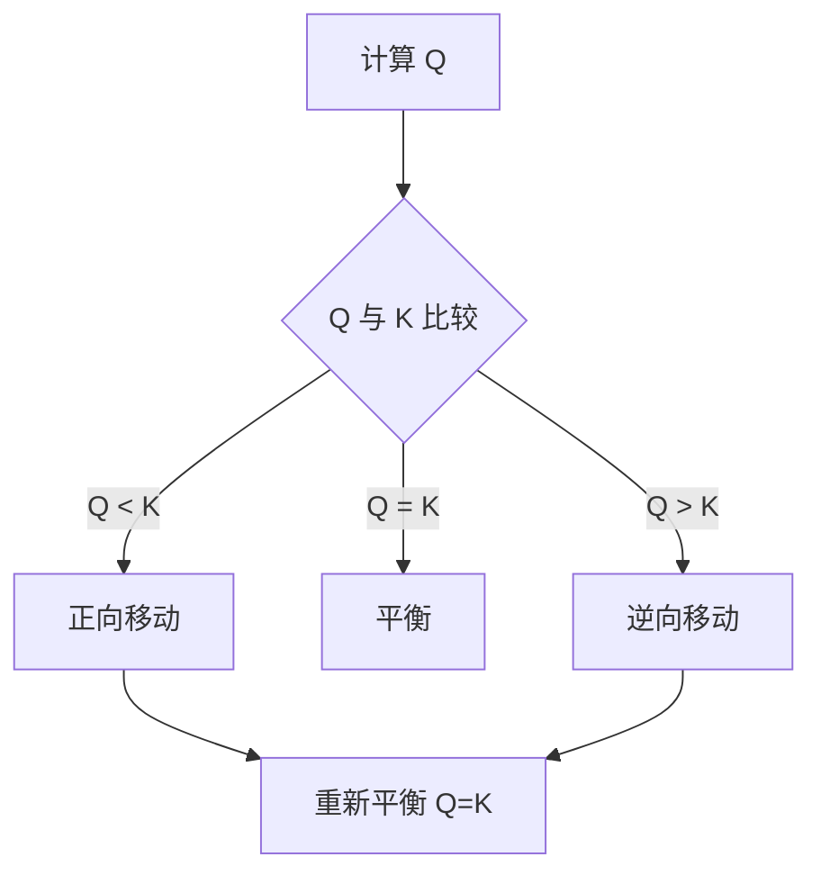

# 第 5 章：化学平衡

- **难度**：★★★ | **预估学时**：1.5 小时 | **前置**：第 3、4 章

## 学习目标
学完本章，你能：
1. 写出平衡常数表达式并计算 K；
2. 用反应商 Q 与 K 比较判断反应方向；
3. 用 ICE 表算平衡浓度；
4. 判断浓度、压强、温度改变时平衡如何移动。

## 一句话核心
平衡常数 K 只随温度变化；Q 与 K 的比较告诉你反应往哪边走。

## 零基础讲解

### 概念 1：平衡常数（难度：进阶）

对一般反应 $aA + bB \rightleftharpoons cC + dD$，平衡时：

$$K_c = \frac{[C]^c [D]^d}{[A]^a [B]^b}$$

纯固体和纯液体不写进表达式，因为它们的"浓度"是常数。气体可以用分压表示，得到 Kp：

$$K_p = \frac{p_C^c p_D^d}{p_A^a p_B^b}$$

Kp 与 Kc 的关系：$K_p = K_c (RT)^{\Delta n}$，Δn 是气体分子数变化。

K 的大小说明反应进行的程度：K 很大（>10⁵），基本进行完全；K 很小（<10⁻⁵），几乎不反应；K 在中间，是可逆反应。

### 概念 2：反应商 Q（难度：进阶）

把当前浓度（不是平衡浓度）代入 K 的表达式，得到反应商 Q。

- Q < K：生成物还不够，反应向正方向进行。
- Q = K：已达平衡。
- Q > K：生成物过多，反应向逆方向进行。

Q 和 K 的表达式形式完全一样，区别只是"当前"还是"平衡"。

### 概念 3：ICE 表计算（难度：高难）

ICE 表是 Initial（初始）、Change（变化）、Equilibrium（平衡）三行表。

例：1.00 L 容器中，初始 0.100 mol H₂ 和 0.100 mol I₂，反应 H₂ + I₂ ⇌ 2HI，K = 64.0，求平衡浓度。

设反应掉 x mol/L：
- H₂：0.100 − x
- I₂：0.100 − x
- HI：2x

代入 K：$64.0 = \frac{(2x)^2}{(0.100-x)^2}$。开方得 $8 = \frac{2x}{0.100-x}$，解得 x = 0.080。
平衡浓度：H₂ = I₂ = 0.020 mol/L，HI = 0.160 mol/L。

开方时要注意正负号，浓度不能为负，取正根。

### 概念 4：平衡移动（难度：进阶）

勒夏特列原理：改变条件，平衡向减弱这种改变的方向移动。
- 加反应物：正向移动。
- 升温：向吸热方向移动，K 随之改变。
- 加压：向气体分子数少的方向移动，K 不变。
- 加催化剂：不移动，K 不变。

注意，K 只受温度影响。浓度、压强改变的是 Q，平衡移动是因为 Q 暂时不等于 K。

## 图示

看图说明：任何移动都是让 Q 重新回到 K。K 本身只有在温度改变时才变。

## 类比与实例

类比：K 是"目标水位"，Q 是"当前水位"。水位低于目标就注水（正向），高于目标就排水（逆向）。这个类比在"温度改变会改变目标水位"这一点上要补一句：升温相当于把刻度线挪了。

实例：合成氨 N₂ + 3H₂ ⇌ 2NH₃，Kp 随温度升高而减小。所以工业上低温有利于产率，但速率太慢，实际取 400–500 ℃。

## 常见误解
- 别以为"平衡常数会随浓度改变"——K 只与温度有关，浓度变了 K 不变。
- 别以为"加催化剂能提高 K"——催化剂只缩短达到平衡的时间。
- 别以为"固体不能写进 K 表达式是因为它不参加反应"——它参加反应，只是活度视为 1。

## 自测题（答案）
1. 对反应 C(s) + CO₂(g) ⇌ 2CO(g)，Kc 的表达式是（ ）。
（答案：$K_c = \frac{[CO]^2}{[CO_2]}$；解析：固体 C 不写入表达式。）

2. 某温度下 K = 10，当前 Q = 5，反应向哪个方向进行？
（答案：正方向；解析：Q < K，生成物不足。）

3. 判断："增大压强，所有反应的平衡都向气体分子数少的方向移动。"
（答案：不对。只有反应前后气体分子数不同的反应，加压才会明显移动；若两边气体分子数相等，加压不移动。）

## 复习锚点
- K 只随温度变，Q 随浓度变。
- Q < K 正向，Q > K 逆向。
- ICE 表：初始、变化、平衡三行，代入 K 解方程。
