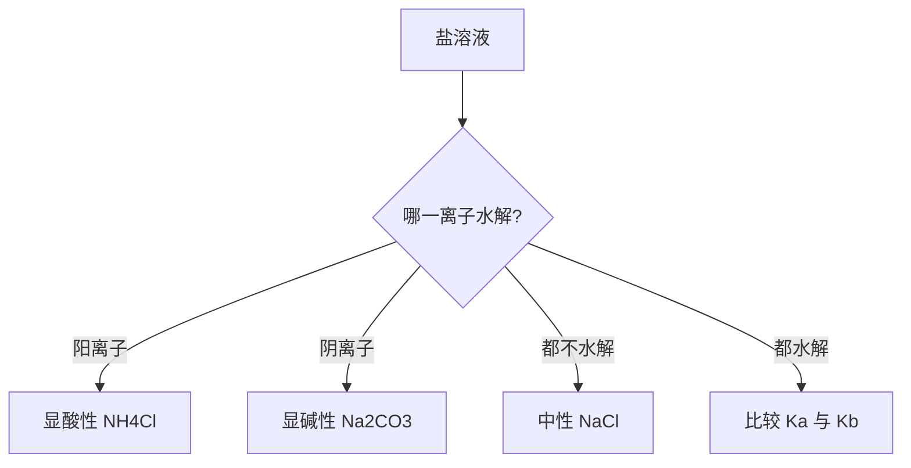

# 第 6 章：酸碱电离平衡与缓冲溶液

- **难度**：★★★ | **预估学时**：1.5 小时 | **前置**：第 5 章

## 学习目标
学完本章，你能：
1. 用 Brønsted 理论判断共轭酸碱对；
2. 算强酸、弱酸、弱碱溶液的 pH；
3. 用 Henderson–Hasselbalch 方程算缓冲溶液 pH；
4. 判断盐溶液的水解酸碱性。

## 一句话核心
酸碱反应是质子转移；弱酸的 Ka 和它的共轭碱 Kb 通过 Kw 联系在一起。

## 零基础讲解

### 概念 1：Brønsted 酸碱理论（难度：基础）

**酸**是能给出质子（H⁺）的物质，**碱**是能接受质子的物质。酸给出质子后变成它的**共轭碱**，碱接受质子后变成它的**共轭酸**。

HCl + H₂O ⇌ H₃O⁺ + Cl⁻：HCl 是酸，Cl⁻ 是它的共轭碱；H₂O 是碱，H₃O⁺ 是它的共轭酸。

水既能当酸又能当碱，叫两性物质。NH₃ 也是碱，接受质子变 NH₄⁺。

### 概念 2：水的电离与 pH（难度：基础）

$$H_2O \rightleftharpoons H^+ + OH^-,\quad K_w = [H^+][OH^-] = 1.0\times10^{-14}\ (25℃)$$

pH = −lg[H⁺]。中性水 pH = 7，酸性 pH < 7，碱性 pH > 7。注意这个"7"只在 25 ℃ 成立，温度升高 Kw 变大，中性 pH 会小于 7。

### 概念 3：弱酸弱碱的电离（难度：进阶）

弱酸 HA 的电离：$K_a = \frac{[H^+][A^-]}{[HA]}$。Ka 越大，酸性越强。

计算 0.10 mol/L CH₃COOH（Ka = 1.8×10⁻⁵）的 pH：
设 [H⁺] = x，近似 $K_a \approx \frac{x^2}{0.10 - x} \approx \frac{x^2}{0.10}$。
$x = \sqrt{K_a \times 0.10} = \sqrt{1.8\times10^{-6}} = 1.34\times10^{-3}$，pH = 2.87。

近似条件：Ka 很小、解离度 < 5% 时，可以忽略分母里的 x。若不能忽略，就要解一元二次方程。

共轭碱的 Kb 与 Ka 的关系：$K_a \cdot K_b = K_w$。所以酸越弱，其共轭碱越强。

### 概念 4：缓冲溶液（难度：高难）

缓冲溶液由弱酸及其共轭碱（或弱碱及其共轭酸）组成，能抵抗少量酸碱，pH 基本不变。

Henderson–Hasselbalch 方程：

$$pH = pK_a + \lg\frac{[A^-]}{[HA]}$$

当 [A⁻] = [HA] 时，pH = pKa，缓冲能力最强。缓冲范围大约是 pKa ± 1。

例：0.10 mol/L CH₃COOH 与 0.10 mol/L CH₃COONa 等体积混合，pKa = 4.74，pH = 4.74。

### 概念 5：盐的水解（难度：进阶）

盐溶于水后，离子与水反应改变 pH：
- 强酸强碱盐（NaCl）：不水解，中性。
- 强酸弱碱盐（NH₄Cl）：NH₄⁺ 水解显酸性。
- 强碱弱酸盐（Na₂CO₃）：CO₃²⁻ 水解显碱性。
- 弱酸弱碱盐（NH₄Ac）：两者都水解，酸碱性看 Ka 与 Kb 的相对大小。

## 图示

看图说明：先看盐由谁构成，再判断哪个离子能水解。两边都水解时，比较常数大小。

## 类比与实例

类比：缓冲溶液像水库。加一点水（加酸）水位上升不多，放一点水（加碱）水位下降不多，因为库容大。这个类比在"缓冲容量有限"处要补一句：加太多酸，水库也会溢。

实例：人体血液 pH 维持在 7.35–7.45，主要靠 H₂CO₃ / HCO₃⁻ 缓冲体系。如果 pH 低于 7.35 就是酸中毒，高于 7.45 是碱中毒。

## 常见误解
- 别以为"pH = 7 一定是中性"——只在 25 ℃ 成立，高温下中性 pH 小于 7。
- 别以为"弱酸稀释一倍，pH 升高 0.3"——那是强酸的规律，弱酸稀释时电离度增大，pH 变化更小。
- 别以为"缓冲溶液能无限抵抗酸碱"——缓冲容量有限，超过范围就失效。

## 自测题（答案）
1. 0.01 mol/L HCl 的 pH 是多少？
（答案：2；解析：强酸完全电离，[H⁺] = 0.01，pH = −lg0.01 = 2。）

2. 已知 CH₃COOH 的 Ka = 1.8×10⁻⁵，其共轭碱 CH₃COO⁻ 的 Kb 是多少？
（答案：$5.6\times10^{-10}$；解析：Kb = Kw/Ka = 1.0×10⁻¹⁴ / 1.8×10⁻⁵。）

3. 判断："NH₄Cl 溶液显酸性，是因为 NH₄⁺ 能电离出 H⁺。"
（答案：说法不准确。NH₄⁺ 本身不能直接电离出 H⁺，是它作为弱酸与水反应（水解）放出 H⁺，本质是质子转移。）

## 复习锚点
- 酸碱看质子转移，共轭成对。
- Ka·Kb = Kw；酸越弱，共轭碱越强。
- 缓冲 pH = pKa + lg([碱]/[酸])。
