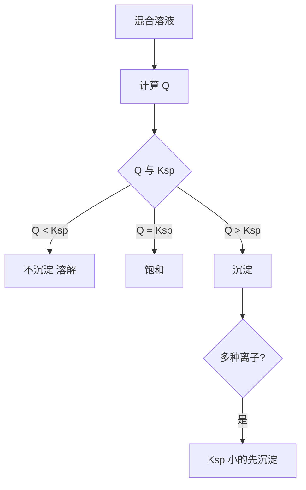

# 第 7 章：沉淀溶解平衡

- **难度**：★★☆ | **预估学时**：1.2 小时 | **前置**：第 5、6 章

## 学习目标
学完本章，你能：
1. 写溶度积 Ksp 表达式；
2. 用 Q 与 Ksp 判断沉淀生成或溶解；
3. 计算同离子效应下的溶解度；
4. 判断沉淀转化和分步沉淀的顺序。

## 一句话核心
难溶电解质并非"完全不溶"，而是溶解与沉淀达到平衡；Ksp 是这种平衡的定量表达。

## 零基础讲解

### 概念 1：溶度积（难度：基础）

对难溶电解质 $A_mB_n(s) \rightleftharpoons mA^{n+} + nB^{m-}$：

$$K_{sp} = [A^{n+}]^m [B^{m-}]^n$$

纯固体不写入表达式。Ksp 只随温度变化，和浓度无关。

例：AgCl 的 Ksp = 1.8×10⁻¹⁰，则饱和溶液中 [Ag⁺][Cl⁻] = 1.8×10⁻¹⁰，溶解度 s = √Ksp ≈ 1.34×10⁻⁵ mol/L。

### 概念 2：溶度积规则（难度：进阶）

把当前离子浓度代入 Ksp 表达式得到 Q：
- Q < Ksp：不饱和，沉淀溶解。
- Q = Ksp：饱和，达到平衡。
- Q > Ksp：过饱和，生成沉淀。

这是判断"加两种溶液会不会产生沉淀"的标准方法。

### 概念 3：同离子效应（难度：进阶）

在饱和溶液中加入含有相同离子的强电解质，平衡向生成沉淀方向移动，溶解度降低。

例：AgCl 在 0.10 mol/L NaCl 中的溶解度。设 s 为溶解度，[Ag⁺] = s，[Cl⁻] ≈ 0.10（来自 NaCl，远大于 s）。
Ksp = s × 0.10 = 1.8×10⁻¹⁰，s = 1.8×10⁻⁹ mol/L。比纯水中的 1.34×10⁻⁵ 小约一万倍。

### 概念 4：沉淀转化与分步沉淀（难度：高难）

**沉淀转化**：溶解度大的沉淀转化为溶解度小的沉淀。如 AgCl 加 KI 变 AgI：
AgCl(s) + I⁻ → AgI(s) + Cl⁻
平衡常数 K = Ksp(AgCl)/Ksp(AgI) = 1.8×10⁻¹⁰ / 8.5×10⁻¹⁷ ≈ 2×10⁶，反应很彻底。

**分步沉淀**：溶液中同时有多种离子，加沉淀剂时，Ksp 小的先沉淀。判断谁先沉淀，要算"开始沉淀所需的沉淀剂浓度"，需要浓度小的先沉淀。

## 图示

看图说明：Q 与 Ksp 的关系就是"过饱和与否"。多种离子共存时，分别算各自的 Q，先达到 Ksp 的先沉淀。

## 类比与实例

类比：Ksp 像电影院满座的票数上限。人少于上限还能进（不饱和），正好满座（饱和），再来人就进不去（沉淀）。这个类比在"同离子效应"处很贴切：门口已经排了同一部电影的长队，能进的人更少。

实例：判断 0.010 mol/L AgNO₃ 与 0.010 mol/L NaCl 等体积混合是否沉淀。混合后浓度各减半，Q = 0.005×0.005 = 2.5×10⁻⁵ > Ksp(AgCl) = 1.8×10⁻¹⁰，产生沉淀。

## 常见误解
- 别以为"Ksp 越小，溶解度一定越小"——只有同类型（如都是 AB 型）才能直接比，AB₂ 与 AB 型不能直接比。
- 别以为"沉淀完全就是离子浓度为 0"——通常指残余离子浓度小于 10⁻⁵ mol/L。
- 别以为"加沉淀剂越多越好"——过量可能引起络合溶解或增加杂质。

## 自测题（答案）
1. 写出 BaSO₄ 的 Ksp 表达式。
（答案：Ksp = [Ba²⁺][SO₄²⁻]；解析：固体不写入。）

2. AgCl 的 Ksp = 1.8×10⁻¹⁰，在纯水中的溶解度约为多少？
（答案：1.34×10⁻⁵ mol/L；解析：s² = Ksp，开方。）

3. 判断："Ksp(AgCl) > Ksp(AgI)，所以向含 Cl⁻、I⁻ 的溶液中加 AgNO₃，AgCl 先沉淀。"
（答案：不对。Ksp 小的 AgI 先沉淀。Ksp 大反而需要更高的 Ag⁺ 浓度才能达到沉淀条件。）

## 复习锚点
- Ksp 只与温度有关，固体不写进表达式。
- Q > Ksp 沉淀，Q < Ksp 溶解。
- 同离子效应降低溶解度；Ksp 小的先沉淀。
