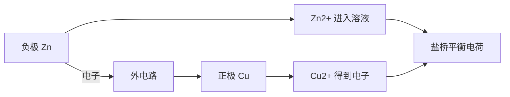

# 第 8 章：氧化还原与电化学

- **难度**：★★★ | **预估学时**：2 小时 | **前置**：第 4、5 章

## 学习目标
学完本章，你能：
1. 用氧化数配平氧化还原方程式；
2. 画出原电池并写出正负极反应；
3. 用标准电极电势判断氧化剂还原剂强弱；
4. 用 Nernst 方程算非标准状态下的电动势。

## 一句话核心
氧化还原是电子转移；原电池把这种转移拆成两半，让电子走外电路做功。

## 零基础讲解

### 概念 1：氧化数与配平（难度：进阶）

**氧化数**是假设把成键电子完全归给电负性大的原子后，某原子所带的电荷数。规则：
- 单质中为 0。
- O 通常为 −2（过氧化物中为 −1，OF₂ 中为 +2）。
- H 通常为 +1（与活泼金属形成的氢化物中为 −1）。
- 化合物中各氧化数代数和为 0，离子等于其电荷。

配平步骤：标氧化数 → 找升降 → 配电子 → 配原子 → 配电荷（酸性补 H⁺，碱性补 OH⁻）→ 查。

### 概念 2：原电池（难度：进阶）

原电池把化学能转成电能。以锌铜电池为例：
- 负极（Zn）：Zn → Zn²⁺ + 2e⁻，发生氧化。
- 正极（Cu）：Cu²⁺ + 2e⁻ → Cu，发生还原。
- 盐桥：平衡两侧电荷，Cl⁻ 向锌侧移动，K⁺ 向铜侧移动。

电子从负极经外电路流向正极，电流方向相反。记法：负极失电子、正极得电子。

### 概念 3：标准电极电势（难度：高难）

**标准电极电势** E° 是电极相对于标准氢电极（E° = 0）的电势，单位 V。代数值越大，氧化型得电子能力越强，是越强的氧化剂。

判断反应方向：E°(氧化剂) > E°(还原剂对应的氧化型)，反应自发。电池电动势：

$$E^\circ_{\text{电池}} = E^\circ_{\text{正极}} - E^\circ_{\text{负极}}$$

E° 越正，反应趋势越大。$\Delta G^\circ = -nFE^\circ$，n 是转移电子数，F = 96500 C/mol。

### 概念 4：Nernst 方程（难度：高难）

非标准状态下：

$$E = E^\circ - \frac{RT}{nF}\ln Q = E^\circ - \frac{0.0592}{n}\lg Q\ (25℃)$$

Q 是反应商，形式与平衡常数相同。浓度降低、分压减小，电极电势改变。例：Cu²⁺ 浓度从 1 mol/L 降到 0.01 mol/L，E 下降约 0.059 V。

### 概念 5：电解与化学电源（难度：进阶）

**电解**是用外加电源迫使非自发反应进行。电解池的阳极接电源正极，发生氧化；阴极接负极，发生还原。

常见化学电源：锌锰干电池、铅酸蓄电池、锂离子电池、氢氧燃料电池。燃料电池的特点是反应物从外部持续输入，能量转换效率高。

## 图示

看图说明：电子只走外电路，离子只走溶液和盐桥。两条路线闭合，电流才能持续。

## 类比与实例

类比：原电池像两个人传球。负极把电子"传"出去，正极接住。盐桥是场边的补给员，保持两边电荷平衡。这个类比在"电极电势决定谁能当负极"这一点上要补一句：传球方向由电势差决定，不是随便定的。

实例：判断 Zn + Cu²⁺ → Zn²⁺ + Cu 能否自发。E°(Cu²⁺/Cu) = +0.34 V，E°(Zn²⁺/Zn) = −0.76 V，电池电动势 = 0.34 − (−0.76) = 1.10 V > 0，自发。

## 常见误解
- 别以为"负极就是阴极"——原电池负极是阳极（氧化），电解池阴极是还原。名称要对准装置类型。
- 别以为"电极电势越负，金属越不活泼"——越负表示越容易失电子，金属越活泼。
- 别以为"E° 与浓度有关"——E° 是标准态的值，浓度影响的是实际电极电势 E。

## 自测题（答案）
1. 原电池中，电子从（ ）极流向（ ）极。
（答案：负、正；解析：负极失电子，电子经外电路流向正极。）

2. 已知 E°(Ag⁺/Ag) = +0.80 V，E°(Cu²⁺/Cu) = +0.34 V，反应 Cu + 2Ag⁺ → Cu²⁺ + 2Ag 的电动势是多少？
（答案：0.46 V；解析：E = 0.80 − 0.34。）

3. 判断："电极电势越大的电对，其氧化型一定是越强的氧化剂。"
（答案：对。E° 越大，得电子能力越强。）

## 复习锚点
- 氧化数配平：电子守恒优先。
- 原电池负极氧化、正极还原；电子走外电路。
- E° 比大小判方向，Nernst 方程修浓度。
