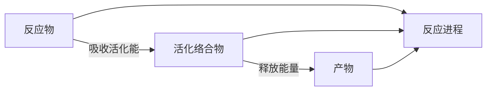

# 第 9 章：化学反应速率

- **难度**：★★☆ | **预估学时**：1.2 小时 | **前置**：第 5 章

## 学习目标
学完本章，你能：
1. 由实验数据确定速率方程和反应级数；
2. 用 Arrhenius 方程算活化能；
3. 解释温度、催化剂、浓度对速率的影响；
4. 区分基元反应和复杂反应机理。

## 一句话核心
速率由活化能和碰撞频率决定；温度升高靠"更多分子越过能垒"，催化剂靠"把能垒降低"。

## 零基础讲解

### 概念 1：速率方程与反应级数（难度：进阶）

对反应 aA + bB → 产物，速率方程写成：

$$v = k[A]^m[B]^n$$

m、n 是实验测得的反应级数，不一定等于方程式系数。只有基元反应，级数才等于系数。

常见类型：
- 零级：v = k，浓度变化不影响速率（如表面催化饱和）。
- 一级：v = k[A]，半衰期与初始浓度无关。
- 二级：v = k[A]² 或 k[A][B]。

由实验数据求级数：看初始浓度加倍时速率变化几倍。浓度加倍、速率加倍 → 一级；速率变 4 倍 → 二级。

### 概念 2：活化能与 Arrhenius 方程（难度：高难）

**活化能** Ea 是反应物分子变成活化分子所需的最小能量。只有能量 ≥ Ea 的分子才能发生有效碰撞。

Arrhenius 方程：

$$k = A e^{-E_a/RT}$$

取对数：$\ln k = \ln A - \frac{E_a}{RT}$。用两个温度下的 k 值可以求 Ea：

$$\ln\frac{k_2}{k_1} = \frac{E_a}{R}\left(\frac{1}{T_1} - \frac{1}{T_2}\right)$$

经验规律：温度每升高 10 ℃，速率约变为原来的 2–4 倍。这不是精确公式，是数量级估计。

### 概念 3：催化剂（难度：进阶）

催化剂改变反应路径，降低活化能，使更多分子能越过能垒。催化剂不改变始末态，所以不影响 ΔH、ΔG 和平衡常数。

催化剂有选择性：一种催化剂只对特定反应有效。酶是生物催化剂，选择性极高。

### 概念 4：反应机理（难度：进阶）

复杂反应由多个基元步骤组成，其中最慢的一步叫**决速步**，它决定整体速率。机理必须满足：各基元步骤相加等于总反应；速率方程与实验一致。

例：H₂ + I₂ → 2HI 曾被当作一步反应，后来实验发现是两步：I₂ ⇌ 2I（快），2I + H₂ → 2HI（慢）。决速步是第二步。

## 图示

看图说明：活化络合物是能量最高点，Ea 是起点到峰顶的高度。催化剂让峰顶变低，反应更容易发生。

## 类比与实例

类比：活化能像翻墙。墙越高，能翻过去的人越少（速率越慢）。升温相当于给每个人更多助跑能量，催化剂相当于在墙上开一个门。这个类比在"催化剂不改变终点高度"这点上正好成立。

实例：某反应 300 K 时 k = 1.0×10⁻³，310 K 时 k = 2.5×10⁻³，求 Ea。
ln(2.5) = Ea/8.314 × (1/300 − 1/310) = Ea/8.314 × 1.075×10⁻⁴。
Ea = 0.916 × 8.314 / 1.075×10⁻⁴ ≈ 70.8 kJ/mol。

## 常见误解
- 别以为"反应级数等于方程式系数"——只有基元反应才相等，复杂反应要实验测。
- 别以为"催化剂能改变平衡常数"——催化剂只改变速率，K 只受温度影响。
- 别以为"活化能越低反应一定越快"——还要看指前因子 A（碰撞频率、取向）。

## 自测题（答案）
1. 某反应浓度加倍，速率变为原来的 4 倍，反应级数是（ ）。
（答案：2；解析：v ∝ [A]²，浓度 2 倍 → 速率 4 倍。）

2. 升高温度，活化分子百分数（ ）。A. 增大 B. 减小 C. 不变 D. 无法判断
（答案：A；解析：能量分布右移，超过 Ea 的分子比例增大。）

3. 判断："催化剂使正反应速率加快，所以平衡向正方向移动。"
（答案：不对。催化剂同等加快正逆反应，平衡不移动。）

## 复习锚点
- 速率方程由实验定，级数看浓度加倍后的倍数。
- Arrhenius：ln k 与 1/T 成直线，斜率 −Ea/R。
- 决速步是最慢的基元步骤。
