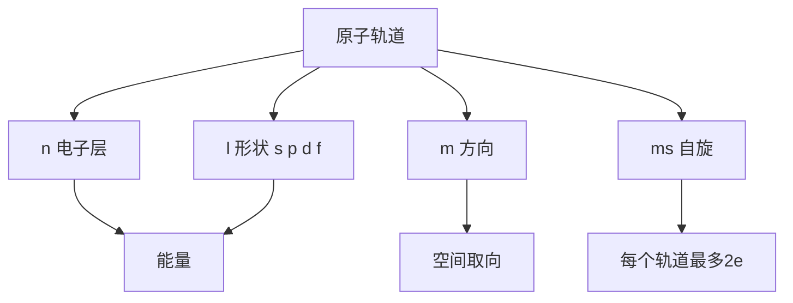

# 第 10 章：原子结构

- **难度**：★★★ | **预估学时**：2 小时 | **前置**：第 4 章、入门篇第 8 章

## 学习目标
学完本章，你能：
1. 说清四个量子数的含义和取值；
2. 写出前 36 号元素的电子排布式；
3. 用 Hund 规则、Pauli 原理、能量最低原理解释排布；
4. 解释原子半径、电离能、电负性的周期性变化。

## 一句话核心
电子没有确定轨道，只有"出现在某处的概率"；量子数描述的就是这种概率分布的形状、方向和能量。

## 零基础讲解

### 概念 1：从 Bohr 到量子力学（难度：进阶）

Bohr 模型假设电子在固定轨道上绕核运动，能解释氢原子光谱，但解释不了多电子原子。量子力学改用**波函数**描述电子，波函数绝对值的平方表示电子出现的概率密度。

**原子轨道**不是"轨道"，而是电子出现概率最大的空间区域。

### 概念 2：四个量子数（难度：高难）

- **主量子数 n**：决定电子层和能量，n = 1, 2, 3…，对应 K、L、M 层。
- **角量子数 l**：决定轨道形状，取值 0 到 n−1，对应 s、p、d、f。
- **磁量子数 m**：决定轨道方向，取值 −l 到 +l，共 2l+1 个。
- **自旋量子数 ms**：只有 +½ 和 −½ 两个值。

一个原子轨道由 n、l、m 三个量子数确定，最多容纳 2 个电子（自旋相反）。第 n 层最多容纳 2n² 个电子。

### 概念 3：电子排布三原则（难度：高难）

- **能量最低原理**：电子先填能量低的轨道。
- **Pauli 不相容原理**：一个轨道最多 2 个电子，且自旋相反。
- **Hund 规则**：简并轨道（能量相同的轨道）上，电子先单独占据，自旋平行。

能级顺序要记：1s < 2s < 2p < 3s < 3p < 4s < 3d < 4p < 5s < 4d < 5p。4s 低于 3d，这是"能级交错"。

例：Fe（26 号）的排布：1s² 2s² 2p⁶ 3s² 3p⁶ 3d⁶ 4s²。写成简化式：[Ar]3d⁶4s²。

### 概念 4：元素性质的周期性（难度：进阶）

- **原子半径**：同周期从左到右减小（核电荷增大，吸引增强）；同主族从上到下增大（电子层增多）。
- **电离能**：气态原子失去 1 个电子所需的最小能量。同周期从左到右增大，同主族从上到下减小。稀有气体电离能最大，碱金属最小。
- **电负性**：原子在化合物中吸引电子的能力。F 最大（4.0），Cs 最小（0.7）。同周期从左到右增大，同主族从上到下减小。

## 图示

看图说明：四个量子数各管一件事，合起来唯一确定一个电子的状态。Pauli 原理限制每个轨道最多两个电子。

## 类比与实例

类比：原子轨道像酒店房间。n 是楼层，l 是房间类型（单间/套房），m 是房间号，ms 是同一张床上最多睡两个人的性别搭配（必须相反）。这个类比在"电子没有确定位置、只有概率"这一点上失效，酒店房间是确定的。

实例：写出 Cr（24 号）的排布。按常规应是 [Ar]3d⁴4s²，但半充满 3d⁵ 更稳定，实际是 [Ar]3d⁵4s¹。这种"半充满、全充满更稳定"的特例要单独记：Cr、Cu。

## 常见误解
- 别以为"电子在固定轨道上绕圈"——量子力学里只有概率分布。
- 别以为"4s 一定比 3d 先填满"——能级交错，4s 先填，但失电子时先失 4s。
- 别以为"电负性越大，非金属性一定越强"——总体成立，但要结合具体反应判断。

## 自测题（答案）
1. n = 3 时，l 可以取哪些值？
（答案：0、1、2；解析：l 取 0 到 n−1。）

2. 某元素排布为 1s²2s²2p⁶3s²3p⁵，它是（ ）号元素。
（答案：17，氯；解析：电子总数 2+2+6+2+5=17。）

3. 判断："同一周期从左到右，原子半径逐渐增大。"
（答案：不对。核电荷增大，对电子吸引增强，半径逐渐减小。）

## 复习锚点
- 四个量子数：n 层、l 形、m 向、ms 旋。
- 排布三原则：能量最低、Pauli、Hund。
- 周期规律：同周期右移半径减小、电负性增大。
