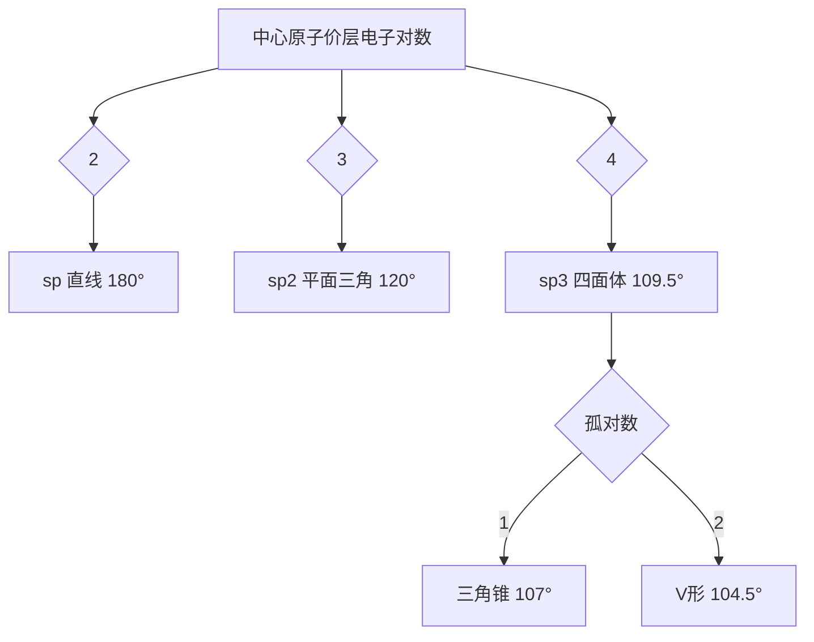

# 第 11 章：化学键与分子结构

- **难度**：★★★ | **预估学时**：2 小时 | **前置**：第 10 章

## 学习目标
学完本章，你能：
1. 画出常见分子的 Lewis 结构；
2. 用 VSEPR 理论判断分子空间构型；
3. 判断中心原子的杂化类型；
4. 解释分子的极性和分子间作用力。

## 一句话核心
分子形状由"中心原子周围电子对互相排斥"决定；杂化轨道是原子为了成键而重新组合的轨道。

## 零基础讲解

### 概念 1：Lewis 结构（难度：进阶）

Lewis 结构用短线表示共用电子对，用点表示孤对电子。画法：
1. 算总价电子数（各原子价电子之和，阴离子加电荷、阳离子减电荷）。
2. 确定中心原子，通常电负性小的放中间。
3. 用单键连接，剩余电子先给外围原子补满八隅体。
4. 不够就形成双键或三键。
5. 检查形式电荷，尽量小。

例：CO₂ 共 16 个价电子，O=C=O，每个 O 有两对孤对电子。

### 概念 2：VSEPR 理论（难度：高难）

**价层电子对互斥理论**：中心原子周围的电子对（成键对 + 孤对）互相排斥，尽量远离，形成特定构型。

先算中心原子的价层电子对数：

$$\text{对数} = \frac{\text{中心原子价电子数} + \text{配体提供的电子数} \pm \text{电荷}}{2}$$

配体 H、卤素各提供 1 个电子，O、S 提供 0 个（按双键算）。

电子对数与构型：
- 2 对：直线形（CO₂、BeCl₂）
- 3 对：平面三角形（BF₃）；有 1 对孤对时 V 形（SO₂）
- 4 对：四面体（CH₄）；1 对孤对三角锥（NH₃）；2 对孤对 V 形（H₂O）
- 5 对：三角双锥（PCl₅）
- 6 对：八面体（SF₆）

孤对电子排斥力大于成键电子对，所以键角会被压缩：CH₄ 109.5°，NH₃ 107°，H₂O 104.5°。

### 概念 3：杂化轨道（难度：高难）

杂化是原子轨道重新组合，形成能量相同、方向更合理的新轨道，便于成键。

- sp³ 杂化：1 个 s + 3 个 p，4 个等价轨道，四面体，键角 109.5°。CH₄、NH₃、H₂O 的中心原子都是 sp³。
- sp² 杂化：1 个 s + 2 个 p，3 个轨道，平面三角形，键角 120°。C₂H₄ 的双键碳、BF₃、苯环碳。
- sp 杂化：1 个 s + 1 个 p，2 个轨道，直线形，键角 180°。C₂H₂、CO₂。

判断杂化：看中心原子的价层电子对数（σ 键数 + 孤对数），2 → sp，3 → sp²，4 → sp³。注意双键、三键里只有 1 个 σ 键参与杂化判断。

### 概念 4：分子极性与分子间作用力（难度：进阶）

**极性分子**：正负电荷中心不重合，如 HCl、H₂O、NH₃。
**非极性分子**：正负电荷中心重合，如 CO₂、CH₄、CCl₄、BF₃。

判断要看两步：键是否有极性 + 分子是否对称。CO₂ 的 C=O 键有极性，但分子直线对称，整体非极性。

分子间作用力包括色散力、取向力、诱导力和氢键。色散力所有分子都有，分子越大越强。氢键只发生在 H 与 N、O、F 相连时。

## 图示

看图说明：电子对数先定杂化和大构型，孤对数再修正键角。两步走，不要跳。

## 类比与实例

类比：杂化像把四把长短不一的椅子腿锯齐、重新摆方向，好让四条腿稳稳落地。s 和 p 轨道原本形状能量不同，杂化后变成四把一样的"椅子腿"。这个类比在"杂化需要能量输入"这一点上要补一句：杂化本身耗能，但成键放出的能量更多，总体有利。

实例：判断 H₂O 的构型。O 有 6 个价电子，2 个 H 各提供 1 个，共 8 个 → 4 对电子，sp³ 杂化。其中 2 对是孤对，所以是 V 形，键角 104.5°。

## 常见误解
- 别以为"有极性键的分子一定是极性分子"——CO₂、CCl₄ 有极性键，但分子对称，整体非极性。
- 别以为"VSEPR 只看成键电子对"——孤对也要算，而且排斥更强。
- 别以为"杂化轨道数等于原子轨道数"——几轨道参与就生成几轨道，数目守恒。

## 自测题（答案）
1. CH₄ 的中心原子杂化类型是（ ）。A. sp B. sp² C. sp³ D. 未杂化
（答案：C；解析：4 个 σ 键、无孤对，4 对电子，sp³。）

2. NH₃ 的空间构型是（ ）。A. 平面三角形 B. 三角锥 C. 四面体 D. 直线形
（答案：B；解析：4 对电子中有 1 对孤对，三角锥。）

3. 判断："CO₂ 是极性分子，因为 C=O 键是极性键。"
（答案：不对。分子直线对称，正负电荷中心重合，是非极性分子。）

## 复习锚点
- Lewis 先数电子，VSEPR 再算电子对。
- 电子对数 2/3/4 对应 sp/sp²/sp³。
- 极性 = 键有极性 + 分子不对称。
