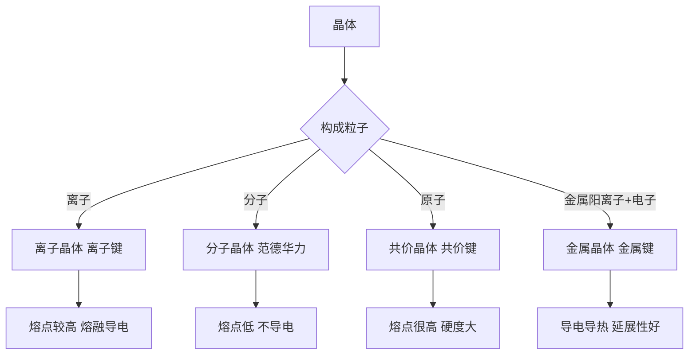

# 第 12 章：晶体结构与配位化合物

- **难度**：★★★ | **预估学时**：1.5 小时 | **前置**：第 11 章

## 学习目标
学完本章，你能：
1. 区分四类晶体并判断其性质；
2. 说出配位化合物的组成；
3. 写出配离子的电荷和中心离子配位数；
4. 命名常见的配位化合物。

## 一句话核心
晶体的性质由"构成晶体的粒子种类和粒子间作用力"决定；配合物是中心离子与配体通过配位键结合的统一整体。

## 零基础讲解

### 概念 1：四类晶体（难度：进阶）

| 晶体类型 | 构成粒子 | 作用力 | 熔点 | 导电性 | 例子 |
|---|---|---|---|---|---|
| 离子晶体 | 阴、阳离子 | 离子键 | 较高 | 熔融或水溶液导电 | NaCl、MgO |
| 分子晶体 | 分子 | 范德华力/氢键 | 低 | 一般不导电 | 冰、干冰、I₂ |
| 原子晶体（共价晶体） | 原子 | 共价键 | 很高 | 一般不导电 | 金刚石、SiO₂、SiC |
| 金属晶体 | 金属阳离子+自由电子 | 金属键 | 差异大 | 良导电 | Cu、Fe、Na |

判断晶体类型，先看构成粒子，再看作用力强弱。金刚石硬度最大，因为整个晶体是一个巨大的共价网络。

### 概念 2：配位化合物的组成（难度：进阶）

配合物由**中心离子（或原子）**和**配体**通过**配位键**结合成**配离子**，再与外界离子组成。

例：[Cu(NH₃)₄]SO₄
- 中心离子：Cu²⁺
- 配体：NH₃
- 配位数：4
- 内界：[Cu(NH₃)₄]²⁺
- 外界：SO₄²⁻

配位键是配体提供孤对电子、中心离子提供空轨道形成的。配位数常见 2、4、6。

### 概念 3：命名（难度：进阶）

命名顺序：阴离子在前，阳离子在后；配体数用一、二、三表示；配体名称加"合"；中心离子用罗马数字标氧化数。

- [Cu(NH₃)₄]SO₄：硫酸四氨合铜(Ⅱ)
- K₃[Fe(CN)₆]：六氰合铁(Ⅲ)酸钾
- [Ag(NH₃)₂]⁺：二氨合银(Ⅰ)配离子

常见配体名称：NH₃ 氨、H₂O 水、CN⁻ 氰、Cl⁻ 氯、OH⁻ 羟、CO 羰。

### 概念 4：配合物的稳定性与异构（难度：高难）

配合物的稳定程度用**稳定常数** K稳 表示，K稳 越大越稳定。例如 [Cu(NH₃)₄]²⁺ 的 K稳 = 2.1×10¹³。

配合物也有异构现象：
- 电离异构：[Co(NH₃)₅Br]SO₄ 与 [Co(NH₃)₅SO₄]Br
- 几何异构：平面正方形配合物的顺反异构
- 旋光异构：手性配合物

## 图示

看图说明：先认粒子，再推性质。四类晶体的性质差异都能从作用力强弱解释。

## 类比与实例

类比：配合物像"中心离子当主人，配体当客人围着坐"。客人数量就是配位数，客人坐的位置决定几何构型。这个类比在"配体可以交换、配合物会解离"这一点上要补一句：客人可以来去，配合物在溶液中是动态平衡。

实例：计算 [Fe(CN)₆]³⁻ 中 Fe 的氧化数。CN⁻ 带 1 个单位负电，6 个共 −6；配离子总电荷 −3，设 Fe 为 x，x − 6 = −3，x = +3。所以是铁(Ⅲ)。

## 常见误解
- 别以为"分子晶体的分子内没有共价键"——分子内是共价键，分子间才是范德华力。
- 别以为"配位数等于配体个数"——一个多齿配体可以占多个配位位点，配位数看配位原子数。
- 别以为"配合物一定溶于水"——有些配合物难溶，如 AgCl 加氨水生成可溶配合物是特例。

## 自测题（答案）
1. 下列晶体中熔点最高的是（ ）。A. NaCl B. 干冰 C. 金刚石 D. 冰
（答案：C；解析：金刚石是共价晶体，整个晶体由共价键连接。）

2. [Cu(NH₃)₄]²⁺ 的中心离子和配位数分别是（ ）。
（答案：Cu²⁺、4；解析：4 个 NH₃ 配体，配位数 4。）

3. 命名 K₃[Fe(CN)₆]。
（答案：六氰合铁(Ⅲ)酸钾；解析：配体 CN⁻ 6 个，Fe 为 +3，外界 K⁺。）

## 复习锚点
- 四类晶体：离子、分子、共价、金属，性质由作用力定。
- 配合物 = 中心离子 + 配体 + 配位键。
- 命名：配体数 + 配体名 + 合 + 中心离子(氧化数)。
