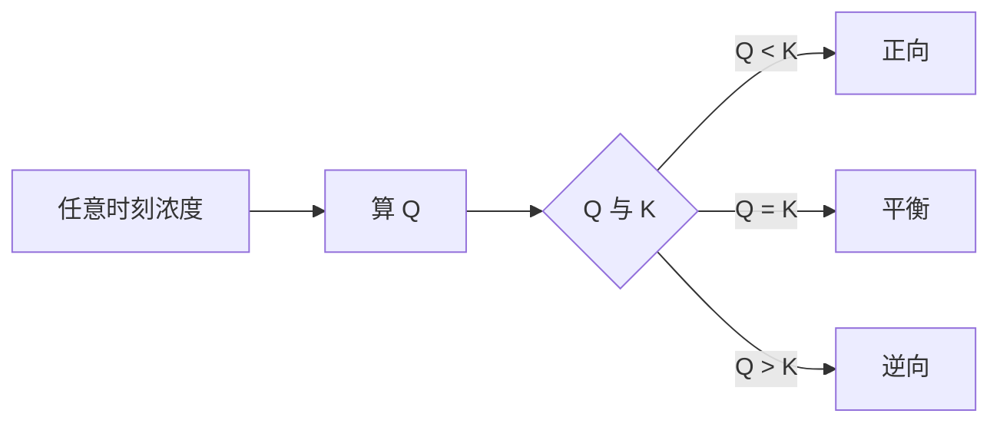

# 化学平衡常数

- **难度**：进阶 | **涉及章节**：第 5 章

## 一句话定义
平衡常数 K 是平衡时生成物浓度幂之积与反应物浓度幂之积的比值，只随温度变化。

## 为什么重要
它把"反应能进行到什么程度"变成一个数。K 大，反应几乎进行完全；K 小，反应几乎不发生。它也是判断反应方向的标尺：Q 与 K 比较，就知道该往哪边走。

## 图示

## 详解

K 的表达式中，纯固体和纯液体不写，因为它们的浓度视为常数。气体用分压时得到 Kp，Kp = Kc(RT)^Δn。

K 只与温度有关：升温，放热反应的 K 减小，吸热反应的 K 增大。浓度、压强、催化剂都不改变 K。

计算平衡浓度用 ICE 表：初始、变化、平衡三行。设变化量为 x，代入 K 解方程，注意取正根、检查浓度不为负。

## 常见误解
- 别以为"加催化剂能提高 K"——K 只受温度影响。
- 别以为"平衡时各物质浓度相等"——相等的是正逆反应速率，不是浓度。
- 别以为"K 越大反应越快"——K 是热力学量，速率看活化能。

## 在书中出现的脉络
| 章节 | 语境 | 关键结论 |
|---|---|---|
| 普化第 4 章 | ΔG° = −RTlnK | 热力学与平衡的桥梁 |
| 普化第 5 章 | K、Q、ICE 表 | 判断方向与算浓度 |
| 普化第 6 章 | Ka、Kb、Kw | K 在酸碱中的具体形式 |

## 相关概念
- 前置：吉布斯自由能、浓度
- 后续：酸碱平衡、沉淀溶解平衡、电极电势
