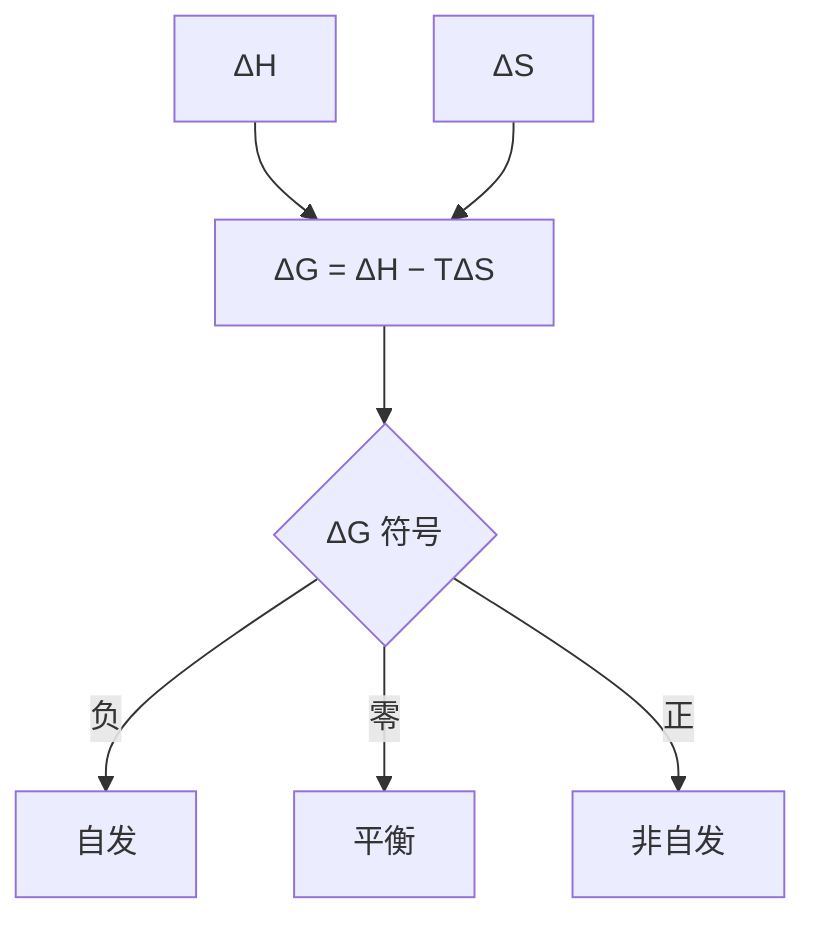

# 吉布斯自由能

- **难度**：高难 | **涉及章节**：第 4 章

## 一句话定义
吉布斯自由能 G = H − TS，恒温恒压下 ΔG < 0 的过程自发。

## 为什么重要
它把"放热"和"熵增"两个自发趋势合成一个判据。只看焓会误判（有些吸热反应也自发），只看熵也会误判（水结冰熵减却自发）。ΔG 是化学热力学的总开关。

## 图示

## 详解

ΔG 是状态函数，只与始末态有关。标准吉布斯自由能变 ΔG° 对应标准态，非标准态要用 ΔG = ΔG° + RTlnQ 修正。

四种符号组合决定温度依赖。转折温度 T = ΔH/ΔS，此时 ΔG = 0。

ΔG° 与 K 的关系：ΔG° = −RTlnK。这个式子说明，K 是 ΔG° 的指数形式：ΔG° 越负，K 越大。

## 常见误解
- 别以为"ΔG < 0 反应就一定快"——ΔG 只管方向，不管速率。
- 别以为"ΔG < 0 反应一定能观察到"——若活化能极高，动力学上可能几乎不发生。
- 别以为"ΔG 与浓度无关"——ΔG° 与浓度无关，实际 ΔG 与 Q 有关。

## 在书中出现的脉络
| 章节 | 语境 | 关键结论 |
|---|---|---|
| 普化第 4 章 | 自发判据 | ΔG = ΔH − TΔS |
| 普化第 5 章 | ΔG° = −RTlnK | K 的热力学来源 |
| 普化第 8 章 | ΔG° = −nFE° | 电化学与热力学 |

## 相关概念
- 前置：焓、熵
- 后续：化学平衡、电化学

