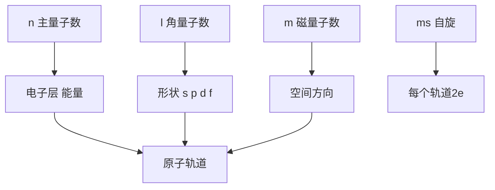

# 原子轨道与量子数

- **难度**：高难 | **涉及章节**：第 10 章

## 一句话定义
原子轨道是电子出现概率最大的空间区域，由 n、l、m 三个量子数确定形状、方向和能量。

## 为什么重要
它解释周期表为什么这样排、元素性质为什么周期性变化。没有轨道概念，电子排布就只能死记；有了它，4s 先于 3d、Cr 和 Cu 的反常，都能推出来。

## 图示

## 详解

n = 1,2,3…，对应 K、L、M 层。l = 0…n−1，l=0 是 s（球形），l=1 是 p（哑铃形），l=2 是 d，l=3 是 f。m = −l…+l，共 2l+1 个方向。ms = ±½。

每层最多 2n² 个电子：n=1 有 2 个，n=2 有 8 个，n=3 有 18 个。

电子排布三原则：能量最低、Pauli 不相容、Hund 规则。能级顺序 1s<2s<2p<3s<3p<4s<3d<4p，4s 与 3d 交错。

## 常见误解
- 别以为"电子沿固定轨道运动"——只有概率分布。
- 别以为"4s 填满后才填 3d"——4s 先填，但失电子时先失 4s。
- 别以为"轨道是圆的"——s 是球形，p 是哑铃形，d、f 更复杂。

## 在书中出现的脉络
| 章节 | 语境 | 关键结论 |
|---|---|---|
| 普化第 10 章 | 量子数与排布 | 2n²、能级交错 |
| 普化第 11 章 | 成键 | 轨道重叠形成共价键 |
| 无机第 1 章 | 分区 | 价电子构型决定分区 |

## 相关概念
- 前置：原子结构、电子
- 后续：化学键、杂化轨道
