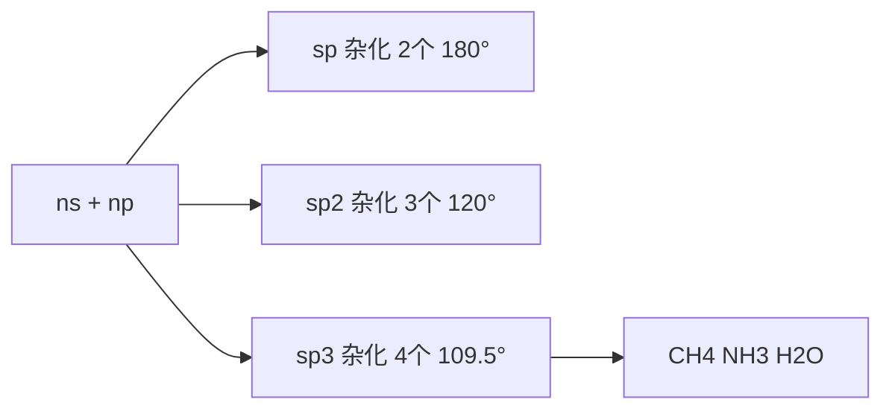

# 杂化轨道

- **难度**：高难 | **涉及章节**：第 11 章

## 一句话定义
杂化是中心原子的若干原子轨道重新组合成一组能量相同、方向更合理的新轨道，用来解释分子的空间构型。

## 为什么重要
没有杂化，碳的 2s 和 2p 轨道一个是球形、三个是哑铃形，无法解释 CH₄ 的四个等价 C—H 键和 109.5° 键角。杂化把"观测到的构型"和"原子轨道"对上号。

## 图示

## 详解

判断杂化类型，数中心原子的价层电子对数（σ 键数 + 孤对数）：
- 2 对 → sp，直线形；
- 3 对 → sp²，平面三角形；
- 4 对 → sp³，四面体。

孤对会压缩键角：CH₄ 109.5°，NH₃ 107°，H₂O 104.5°。孤对排斥大于成键对，因为孤对只受一个原子核束缚，电子云更"胖"。

杂化轨道只用于形成 σ 键和容纳孤对；π 键由未参与杂化的 p 轨道肩并肩形成。所以双键 = 1 个 σ + 1 个 π，三键 = 1 个 σ + 2 个 π。

## 常见误解
- 别以为"杂化后轨道数变了"——几个轨道参与，就生成几个杂化轨道，数目守恒。
- 别以为"杂化一定降低能量"——杂化本身耗能，但成键放能更多，总体有利。
- 别以为"所有分子都要杂化"——H₂ 这类双原子分子不需要，直接用 s 轨道重叠。

## 在书中出现的脉络
| 章节 | 语境 | 关键结论 |
|---|---|---|
| 普化第 11 章 | VSEPR 与杂化 | 电子对数定杂化 |
| 有机第 2 章 | 烷烃 | sp³ 四面体 |
| 有机第 3 章 | 烯烃 | sp² 平面，π 键 |

## 相关概念
- 前置：原子轨道、VSEPR
- 后续：共轭、芳香性
