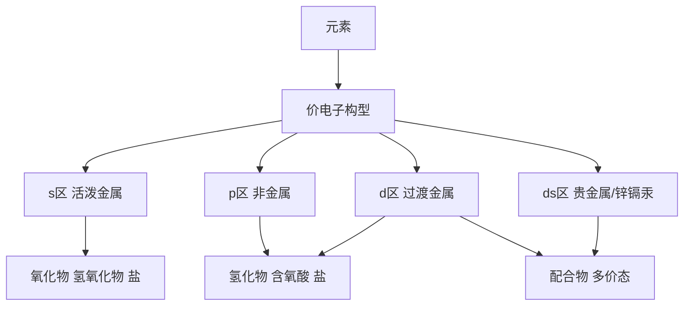

# 第 1 章：元素周期律与无机化学地图

- **难度**：★★☆ | **预估学时**：1 小时 | **前置**：普化第 10 章

## 学习目标
学完本章，你能：
1. 按周期表分区说出元素的大致性质；
2. 用"价电子构型"判断元素属于主族、过渡金属还是 f 区；
3. 建立无机化学的学习地图（结构—性质—制备—用途）。

## 一句话核心
无机化学不是背反应，而是用"构型决定性质、性质决定用途"这条线，把几百种物质串起来。

## 零基础讲解

### 概念 1：周期表的五个区（难度：基础）

- **s 区**：第 ⅠA、ⅡA 族，价电子构型 ns¹⁻²，活泼金属。
- **p 区**：第 ⅢA–ⅦA 族及 0 族，价电子 ns²np¹⁻⁶，非金属与半金属集中在这里。
- **d 区**：第 ⅢB–ⅧB 族（过渡金属），价电子 (n−1)d¹⁻¹⁰ns¹⁻²。
- **ds 区**：第 ⅠB、ⅡB 族，价电子 (n−1)d¹⁰ns¹⁻²，Cu、Ag、Au、Zn、Cd、Hg。
- **f 区**：镧系、锕系，价电子 (n−2)f¹⁻¹⁴。

记分区的好处是：同一区元素性质相似，反应类型也相似。

### 概念 2：周期性规律的四条主线（难度：进阶）

1. **原子半径**：同周期右移减小，同主族下移增大。
2. **电离能**：同周期右移增大，同主族下移减小。注意 ⅡA 与 ⅢA、ⅤA 与 ⅥA 之间有反常（半充满、全充满更稳定）。
3. **电负性**：同周期右移增大，同主族下移减小。F 最大。
4. **金属性/非金属性**：同周期右移非金属性增强，同主族下移金属性增强。

### 概念 3：无机物的四条性质线（难度：进阶）

学习一种元素，按四条线整理：
- **单质**：颜色、状态、与酸/碱/水的反应。
- **氧化物**：酸性/碱性/两性，与水反应生成什么酸或碱。
- **氢化物**：稳定性、酸碱性、还原性。
- **含氧酸及其盐**：酸性强弱、氧化性、热稳定性、溶解性。

比如学硫：单质黄色固体，燃烧生成 SO₂；SO₂ 是酸性氧化物，溶于水生成 H₂SO₃；SO₃ 溶于水生成 H₂SO₄；H₂SO₄ 是强酸，浓硫酸有强氧化性和吸水性。

### 概念 4：无机反应的四种类型（难度：基础）

- 单质 + 单质 → 化合物（化合）
- 化合物 → 单质 + 化合物（分解、置换）
- 氧化物 + 水 → 酸/碱
- 酸 + 碱 → 盐 + 水；盐 + 盐 → 新盐 + 新盐

绝大多数无机反应可以归入这四类，剩下的是氧化还原和配位反应。

## 图示

看图说明：构型决定分区，分区决定主要化合物类型。这张图是后面三章的地图。

## 类比与实例

类比：周期表像一座城市的分区地图。s 区是"金属工业区"，p 区是"非金属生活区"，d 区是"多价态商业区"。这个类比在"分区边界元素性质模糊"处失效，比如硼、硅既有金属性又有非金属性。

实例：比较 Na、Mg、Al 的金属性。同周期从左到右，核电荷增大、半径减小，失电子变难，金属性减弱：Na > Mg > Al。对应最高价氢氧化物碱性：NaOH > Mg(OH)₂ > Al(OH)₃（Al(OH)₃ 两性）。

## 常见误解
- 别以为"d 区元素都是+2 价"——过渡金属有多种价态，如 Fe 有 +2、+3，Mn 有 +2 到 +7。
- 别以为"同周期电离能一定单调增大"——ⅡA 到 ⅢA、ⅤA 到 ⅥA 有回落。
- 别以为"金属氧化物都是碱性氧化物"——Al₂O₃、ZnO 是两性氧化物。

## 自测题（答案）
1. 下列元素属于 p 区的是（ ）。A. Na B. Fe C. S D. Ag
（答案：C；解析：S 的价电子构型 3s²3p⁴，属 p 区。）

2. 比较 F、Cl、Br 的非金属性强弱。
（答案：F > Cl > Br；解析：同主族从上到下非金属性减弱。）

3. 判断："Al₂O₃ 既能与酸反应又能与碱反应，所以它是碱性氧化物。"
（答案：不对。它是两性氧化物。）

## 复习锚点
- 五个区按价电子构型分。
- 四条周期性主线：半径、电离能、电负性、金属性。
- 学元素按单质、氧化物、氢化物、含氧酸四条线走。
