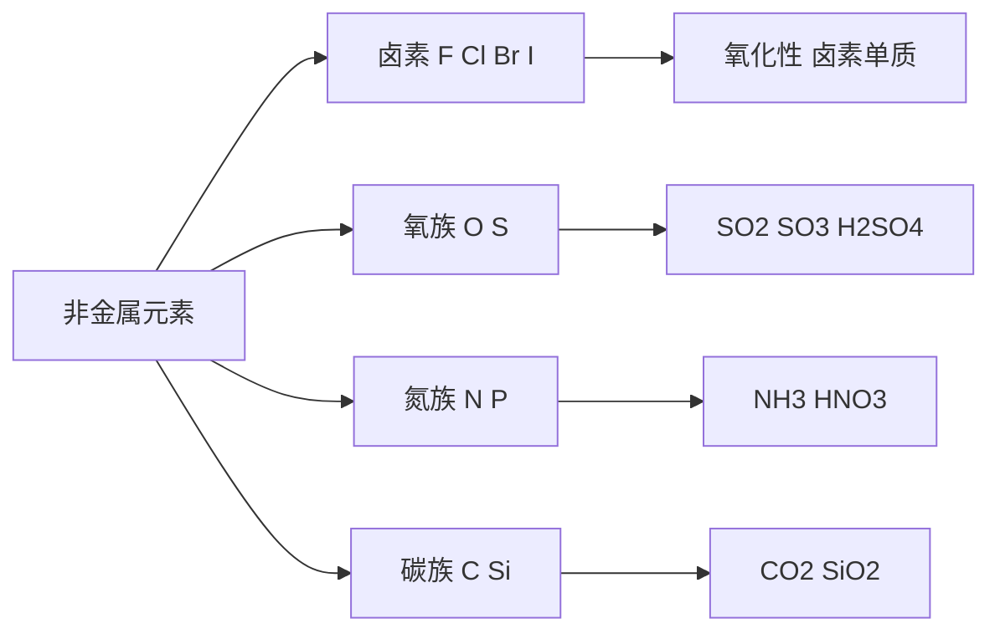

# 第 2 章：非金属元素

- **难度**：★★★ | **预估学时**：2 小时 | **前置**：第 1 章、普化第 8 章

## 学习目标
学完本章，你能：
1. 写出卤素、氧、硫、氮、磷、碳、硅的主要反应；
2. 比较非金属性强弱和氢化物稳定性；
3. 解释含氧酸酸性强弱的变化规律；
4. 记住几个工业制备反应。

## 一句话核心
非金属元素的性质随位置变化：越靠右上，非金属性越强；同族向下，氢化物越不稳定、含氧酸越弱。

## 零基础讲解

### 概念 1：卤素（难度：进阶）

卤素 ⅦA：F₂、Cl₂、Br₂、I₂。颜色由浅黄绿到紫黑，氧化性 F₂ > Cl₂ > Br₂ > I₂。

关键反应：
- Cl₂ + 2NaOH → NaCl + NaClO + H₂O（制漂白液）
- Cl₂ + 2KI → 2KCl + I₂（置换，证明氧化性 Cl₂ > I₂）
- Cl₂ + H₂O ⇌ HCl + HClO（氯水成分，HClO 有漂白性）
- 2Cl₂ + 2Ca(OH)₂ → Ca(ClO)₂ + CaCl₂ + 2H₂O（制漂白粉）

氢化物稳定性：HF > HCl > HBr > HI。氢卤酸酸性：HF 弱酸，HCl、HBr、HI 强酸，且酸性 HF < HCl < HBr < HI。

### 概念 2：氧与硫（难度：进阶）

氧：O₂、O₃（同素异形体）。O₃ 有强氧化性，可消毒。
硫：黄色固体，燃烧发蓝紫色火焰：S + O₂ → SO₂。

硫的化合物：
- SO₂ 是酸性氧化物，溶于水生成 H₂SO₃（弱酸，中强还原性）。
- SO₃ 溶于水生成 H₂SO₄。
- 2SO₂ + O₂ ⇌(催化剂, △) 2SO₃（工业制硫酸的核心步骤）。
- 浓硫酸有吸水性、脱水性、强氧化性。Cu + 2H₂SO₄(浓) → CuSO₄ + SO₂↑ + 2H₂O。

### 概念 3：氮与磷（难度：进阶）

氮气 N₂ 极稳定，因为 N≡N 键能很大（941 kJ/mol）。固氮三条路：高能固氮（闪电）、生物固氮（根瘤菌）、工业合成氨。

- N₂ + 3H₂ ⇌(高温高压催化剂) 2NH₃
- NH₃ 是碱性气体，与水形成 NH₃·H₂O，能使湿润红色石蕊试纸变蓝。
- NH₃ + HCl → NH₄Cl（白烟）
- 4NH₃ + 5O₂ →(Pt, △) 4NO + 6H₂O（催化氧化，工业制硝酸第一步）
- 2NO + O₂ → 2NO₂（红棕色）
- 3NO₂ + H₂O → 2HNO₃ + NO（工业制硝酸）

磷：白磷（P₄，剧毒，易自燃）、红磷（稳定）。P₄ + 5O₂ →(点燃) P₂O₅，P₂O₅ 吸水性强，是干燥剂。

### 概念 4：碳与硅（难度：进阶）

碳：金刚石（共价晶体，硬）、石墨（层状，导电）、C₆₀。CO 有还原性和毒性，CO₂ 是酸性氧化物。

- C + O₂ →(点燃) CO₂
- CO₂ + C →(高温) 2CO（工业制 CO）
- CO + CuO →(△) Cu + CO₂（炼铜）

硅：SiO₂ 是共价晶体，与 NaOH 反应：SiO₂ + 2NaOH → Na₂SiO₃ + H₂O（所以不能用玻璃瓶长期装 NaOH）。工业制粗硅：SiO₂ + 2C →(高温) Si + 2CO↑。

### 概念 5：含氧酸酸性规律（难度：高难）

同一元素不同价态：价态越高，酸性越强。H₂SO₃ < H₂SO₄，HNO₂ < HNO₃。
同一主族从上到下：酸性减弱。HNO₃ > H₃PO₄，H₂SO₄ > H₂SeO₄ 的反例要单独记（实际 H₂SO₄ 与 H₂SeO₄ 接近，H₂SO₄ 略强）。

Pauling 规则：含氧酸 $H_nXO_m$ 的酸性随 m 增大而增强。m = 1 弱酸，m = 2 中强，m = 3 强酸。HClO（m=1）弱，HClO₂（m=2）中强，HClO₃、HClO₄（m=3、4）强。

## 图示

看图说明：按族分块记，每块抓住"单质—氧化物—含氧酸"这条链。跨族比较看非金属性和价态。

## 类比与实例

类比：非金属元素像一支球队，位置越靠右上（F、O），进攻性（氧化性）越强；越往下（I、Se），越"温和"。这个类比在"氮气特别稳定"处失效，因为 N≡N 键能异常大，不按族规律走。

实例：为什么浓硫酸能干燥 SO₂ 却不能干燥 NH₃？浓硫酸有酸性，NH₃ 是碱性气体，两者反应生成 (NH₄)₂SO₄；SO₂ 是酸性氧化物，不与浓硫酸反应，所以可以干燥。

## 常见误解
- 别以为"氯水就是 HCl 和 HClO 的混合物"——氯水是 Cl₂、H₂O、HCl、HClO 多组分平衡体系。
- 别以为"浓硫酸只体现酸性"——浓硫酸还有强氧化性、吸水性、脱水性。
- 别以为"SiO₂ 和 CO₂ 都是酸性氧化物，性质相同"——SiO₂ 是共价晶体，不溶于水，CO₂ 是分子晶体，溶于水。

## 自测题（答案）
1. 下列氢化物最稳定的是（ ）。A. HF B. HCl C. HBr D. HI
（答案：A；解析：F 的非金属性最强，H—F 键最稳定。）

2. 写出氯气与氢氧化钠反应的化学方程式。
（答案：Cl₂ + 2NaOH → NaCl + NaClO + H₂O。）

3. 判断："酸性 HClO₄ > HClO₃ > HClO₂ > HClO。"
（答案：对。含氧酸中氧原子数越多，酸性越强。）

## 复习锚点
- 卤素：氧化性 F₂ > Cl₂ > Br₂ > I₂，氢化物稳定性反之。
- 硫：SO₂ 还原性、SO₃ 制硫酸、浓硫酸三性。
- 氮：合成氨、氨的催化氧化、硝酸制备。
- 含氧酸酸性随中心元素价态升高而增强。
