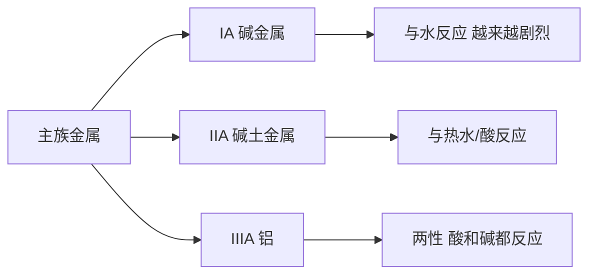

# 第 3 章：主族金属

- **难度**：★★☆ | **预估学时**：1.2 小时 | **前置**：第 1 章

## 学习目标
学完本章，你能：
1. 写出钠、镁、铝与水或酸反应的现象和方程式；
2. 比较碱金属、碱土金属的活泼性；
3. 说明铝的两性；
4. 解释 Na₂O₂ 的特殊性质。

## 一句话核心
主族金属越往下越活泼；铝是"两性金属"，既能与酸反应，也能与强碱反应。

## 零基础讲解

### 概念 1：碱金属（难度：基础）

第 ⅠA 族：Li、Na、K、Rb、Cs。最外层 1 个电子，极易失电子，活泼性从上到下增强。

- 2Na + 2H₂O → 2NaOH + H₂↑（浮、熔、游、响、红）
- 2Na + O₂ →(点燃) Na₂O₂（过氧化钠，淡黄色）
- 2Na₂O₂ + 2H₂O → 4NaOH + O₂↑
- 2Na₂O₂ + 2CO₂ → 2Na₂CO₃ + O₂

Na₂O₂ 中 O 为 −1 价，既有氧化性又有还原性，常作供氧剂（潜水艇、呼吸面具）。Na₂O 是白色固体，碱性氧化物；Na₂O₂ 是过氧化物，不是碱性氧化物。

### 概念 2：碱土金属（难度：基础）

第 ⅡA 族：Be、Mg、Ca、Sr、Ba。最外层 2 个电子，活泼性次于碱金属，从上到下增强。

- Mg + 2H₂O →(△) Mg(OH)₂ + H₂↑（热水才反应）
- Mg + 2HCl → MgCl₂ + H₂↑
- 2Mg + O₂ →(点燃) 2MgO（耀眼白光）
- Ca + 2H₂O → Ca(OH)₂ + H₂↑

MgO 是碱性氧化物，熔点高，作耐火材料。Ca(OH)₂ 微溶，澄清水溶液叫石灰水，通 CO₂ 变浑浊：Ca(OH)₂ + CO₂ → CaCO₃↓ + H₂O。

### 概念 3：铝的两性（难度：进阶）

Al 是第 ⅢA 族，表面易形成致密氧化膜，耐腐蚀。

- 2Al + 6HCl → 2AlCl₃ + 3H₂↑
- 2Al + 2NaOH + 2H₂O → 2NaAlO₂ + 3H₂↑（偏铝酸钠）
- Al₂O₃ + 6HCl → 2AlCl₃ + 3H₂O
- Al₂O₃ + 2NaOH → 2NaAlO₂ + H₂O
- Al(OH)₃ + 3HCl → AlCl₃ + 3H₂O
- Al(OH)₃ + NaOH → NaAlO₂ + 2H₂O

铝热反应：2Al + Fe₂O₃ →(高温) Al₂O₃ + 2Fe，用于焊接钢轨、冶炼难熔金属。

### 概念 4：锡与铅（难度：进阶）

Sn、Pb 是第 ⅣA 族金属。Sn 有 +2、+4 价，Pb 以 +2 价稳定（惰性电子对效应：6s² 不易失去）。
- Sn + 2HCl → SnCl₂ + H₂↑
- Pb + 2HCl → PbCl₂↓ + H₂↑（PbCl₂ 难溶，反应很快停止）

惰性电子对效应：同族向下，ns² 电子对越来越难参与成键，所以 Tl、Pb、Bi 的低价态更稳定。

## 图示

看图说明：活泼性从上到下增强，铝特殊在两性。记反应时先看金属位置，再看条件。

## 类比与实例

类比：碱金属像"急着交作业的学生"，最外层 1 个电子随时准备交出去；碱土金属有 2 个，稍犹豫；铝交了 3 个之后，剩下的核心很稳定，所以既能让酸拿走，也能让碱"溶解"它。这个类比在"铝表面氧化膜保护"这一点上要补一句：铝其实很活泼，只是被膜保护了。

实例：为什么不能用铝锅煮碱性食物？Al₂O₃ 和 Al 都能与 NaOH 反应，保护膜被破坏，铝会继续溶解，既损坏锅又使食物含铝。

## 常见误解
- 别以为"Na₂O₂ 是碱性氧化物"——它是过氧化物，与水反应生成 NaOH 和 O₂，不是简单的碱性氧化物。
- 别以为"铝不活泼"——铝的活泼性接近镁，只是表面氧化膜让它耐腐蚀。
- 别以为"镁不与冷水反应，所以镁不活泼"——镁与热水、酸反应都很剧烈。

## 自测题（答案）
1. 钠与水反应的现象不包括（ ）。A. 浮在水面 B. 熔成小球 C. 沉入水底 D. 四处游动
（答案：C；解析：钠密度比水小，浮在水面。）

2. 写出 Al 与 NaOH 溶液反应的化学方程式。
（答案：2Al + 2NaOH + 2H₂O → 2NaAlO₂ + 3H₂↑。）

3. 判断："Na₂O 和 Na₂O₂ 都是碱性氧化物。"
（答案：不对。Na₂O 是碱性氧化物，Na₂O₂ 是过氧化物。）

## 复习锚点
- 碱金属最活泼，与水反应"浮熔游响红"。
- Na₂O₂ 中 O 为 −1，可作供氧剂。
- 铝两性：与酸、强碱都反应；铝热反应放大量热。
