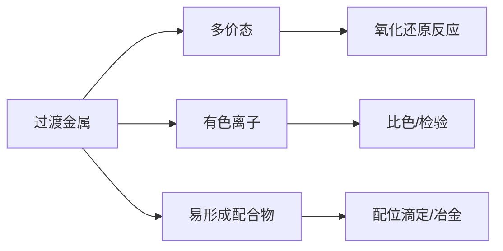

# 第 4 章：过渡金属与配位化合物

- **难度**：★★★ | **预估学时**：1.5 小时 | **前置**：第 1 章、普化第 12 章

## 学习目标
学完本章，你能：
1. 说出铬、锰、铁、铜、银、锌的主要价态和颜色；
2. 写出 Fe²⁺/Fe³⁺ 的相互转化；
3. 解释 Cu²⁺ 与氨水形成配合物的现象；
4. 记住常见离子的检验方法。

## 一句话核心
过渡金属的特点是"多价态 + 有色 + 易形成配合物"，这三条决定了它们的化学行为。

## 零基础讲解

### 概念 1：铬与锰（难度：进阶）

铬：常见 +3、+6。Cr³⁺ 绿色，Cr₂O₇²⁻ 橙色，CrO₄²⁻ 黄色。
- Cr₂O₇²⁻ + 14H⁺ + 6e⁻ → 2Cr³⁺ + 7H₂O（酸性条件，强氧化性）
- 2CrO₄²⁻ + 2H⁺ ⇌ Cr₂O₇²⁻ + H₂O（加酸变橙，加碱变黄）

锰：常见 +2、+4、+7。Mn²⁺ 浅粉色，MnO₂ 黑色，MnO₄⁻ 紫色。
- 2MnO₄⁻ + 5H₂O₂ + 6H⁺ → 2Mn²⁺ + 5O₂↑ + 8H₂O（高锰酸钾滴定双氧水）
- MnO₂ + 4HCl(浓) → MnCl₂ + Cl₂↑ + 2H₂O（实验室制氯气）

### 概念 2：铁（难度：进阶）

铁：+2、+3。Fe²⁺ 浅绿色，Fe³⁺ 黄色。
- 2Fe³⁺ + Fe → 3Fe²⁺（三价铁被铁还原）
- 2Fe²⁺ + Cl₂ → 2Fe³⁺ + 2Cl⁻（二价铁被氯气氧化）
- Fe³⁺ + 3SCN⁻ → Fe(SCN)₃（血红色，检验 Fe³⁺）
- Fe²⁺ + 2OH⁻ → Fe(OH)₂↓（白色，迅速变灰绿，最终红褐）
- Fe³⁺ + 3OH⁻ → Fe(OH)₃↓（红褐色）

检验 Fe³⁺ 用 KSCN，现象血红色；检验 Fe²⁺ 先加 KSCN 不变色，再加氯水变红。

### 概念 3：铜与银（难度：进阶）

铜：+1、+2。Cu²⁺ 蓝色，Cu(OH)₂ 蓝色沉淀，CuSO₄·5H₂O 蓝色晶体。
- Cu + 2H₂SO₄(浓) → CuSO₄ + SO₂↑ + 2H₂O
- 2Cu + O₂ + CO₂ + H₂O → Cu₂(OH)₂CO₃（铜绿）
- Cu²⁺ + 4NH₃ → [Cu(NH₃)₄]²⁺（深蓝色，检验 Cu²⁺）

银：+1。AgCl 白色、AgBr 淡黄、AgI 黄色，溶解度依次减小，可用来检验卤素离子。
- Ag⁺ + Cl⁻ → AgCl↓
- AgCl + 2NH₃ → [Ag(NH₃)₂]⁺ + Cl⁻（银氨溶液）

### 概念 4：锌与配合物（难度：进阶）

锌：+2。Zn²⁺ 无色，ZnO、Zn(OH)₂ 两性。
- Zn + 2HCl → ZnCl₂ + H₂↑
- Zn(OH)₂ + 2NaOH → Na₂[Zn(OH)₄]（四羟基合锌酸钠）

配合物的应用：检验离子（Cu²⁺、Fe³⁺）、湿法冶金（氰化法提金）、配位滴定（EDTA 滴定 Ca²⁺、Mg²⁺、Ni²⁺）、生物体内（血红素是 Fe 配合物、叶绿素是 Mg 配合物）。

## 图示

看图说明：三条特点对应三类应用。看到过渡金属，先想它有哪些价态，再想颜色和配合物。

## 类比与实例

类比：过渡金属像"会变装的人"，同一元素换不同价态就换一套颜色和性质。这个类比在"颜色由 d 电子跃迁产生"这一点上要补一句：颜色不是染料，是电子吸收可见光后跃迁造成的。

实例：为什么 Fe(OH)₂ 沉淀颜色会变？Fe(OH)₂ 白色，被空气氧化：4Fe(OH)₂ + O₂ + 2H₂O → 4Fe(OH)₃，颜色由白→灰绿→红褐。所以实验中要滴加苯隔绝空气，才能看到白色。

## 常见误解
- 别以为"所有过渡金属离子都有颜色"——Zn²⁺、Sc³⁺、Ti⁴⁺ 无色，因为 d 轨道全空或全满。
- 别以为"Fe³⁺ 与 KSCN 反应生成沉淀"——生成的是血红色配合物，不是沉淀。
- 别以为"铜只能被浓硫酸氧化"——铜也能被稀硝酸氧化：3Cu + 8HNO₃(稀) → 3Cu(NO₃)₂ + 2NO↑ + 4H₂O。

## 自测题（答案）
1. 检验 Fe³⁺ 常用的试剂是（ ）。A. NaOH B. KSCN C. BaCl₂ D. AgNO₃
（答案：B；解析：Fe³⁺ 与 SCN⁻ 生成血红色配合物。）

2. Cu²⁺ 与过量氨水反应的现象是（ ）。
（答案：先产生蓝色沉淀，继续加氨水沉淀溶解，溶液变深蓝色；解析：生成 [Cu(NH₃)₄]²⁺。）

3. 判断："Fe²⁺ 与 KSCN 直接反应显血红色。"
（答案：不对。Fe²⁺ 与 KSCN 不显红色，需先氧化为 Fe³⁺。）

## 复习锚点
- 铬：Cr³⁺ 绿、Cr₂O₇²⁻ 橙；锰：MnO₄⁻ 紫。
- 铁：Fe²⁺ 浅绿、Fe³⁺ 黄，KSCN 检验 Fe³⁺。
- 铜：Cu²⁺ 蓝，遇过量氨水生成深蓝色配合物。
