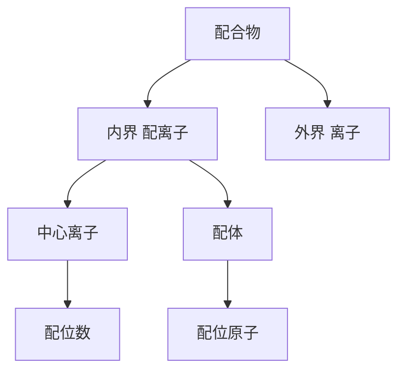

# 配合物与配位键

- **难度**：进阶 | **涉及章节**：普化第 12 章、无机第 4 章

## 一句话定义
配合物是由中心离子（或原子）与配体通过配位键结合成的配离子，再与外界离子组成的化合物。

## 为什么重要
它解释了为什么 AgCl 能溶于氨水、为什么 Cu²⁺ 遇过量氨水变深蓝、为什么血红蛋白能运氧。配合物也是配位滴定、湿法冶金、催化剂的基础。

## 图示

## 详解

以 [Cu(NH₃)₄]SO₄ 为例：中心离子 Cu²⁺，配体 NH₃，配位数 4，内界 [Cu(NH₃)₄]²⁺，外界 SO₄²⁻。

配位键的形成：配体提供孤对电子，中心离子提供空轨道。NH₃ 的 N 有一对孤对，Cu²⁺ 有空的 d 轨道，二者形成配位键。

命名顺序：阴离子在前、阳离子在后；配体数用一、二、三；配体名后加"合"；中心离子用罗马数字标氧化数。K₃[Fe(CN)₆] 叫六氰合铁(Ⅲ)酸钾。

稳定常数 K稳 衡量配合物稳定性，K稳 越大越稳定。配合物在溶液中存在解离平衡，加酸、加沉淀剂可能破坏配合物。

## 常见误解
- 别以为"配位数等于配体个数"——多齿配体一个分子可占多个配位位点。
- 别以为"配合物一定溶于水"——有些难溶，如某些金属配合物沉淀。
- 别以为"配位键是特殊的共价键"——它本质是共价键的一种，电子对由一方提供。

## 在书中出现的脉络
| 章节 | 语境 | 关键结论 |
|---|---|---|
| 普化第 12 章 | 配合物组成 | 内界、外界、配位数 |
| 无机第 4 章 | Cu²⁺、Ag⁺ | 深蓝色、银氨溶液 |
| 无机第 4 章 | 生物配合物 | 血红素、叶绿素 |

## 相关概念
- 前置：共价键、过渡金属
- 后续：配位滴定、晶体场
