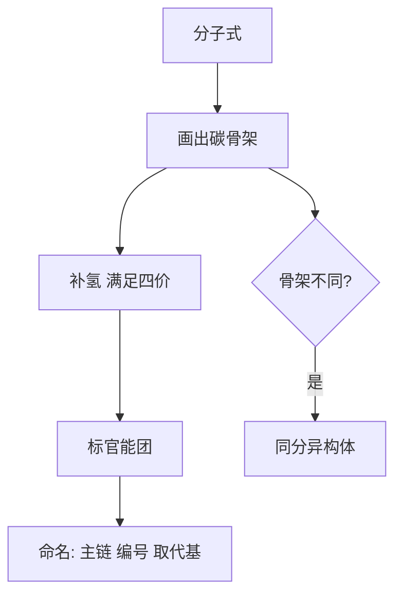

# 第 1 章：有机化学的结构语言

- **难度**：★★☆ | **预估学时**：1.2 小时 | **前置**：入门篇第 10 章

## 学习目标
学完本章，你能：
1. 把分子式展开成构造式、键线式；
2. 认出常见官能团并说出所属类别；
3. 判断两种结构是不是同分异构体；
4. 用"IUPAC 三步法"给简单有机物命名。

## 一句话核心
有机分子靠"碳骨架 + 官能团"两件事描述；同一分子式画出不同骨架，就是不同的物质。

## 零基础讲解

### 概念 1：构造式与键线式（难度：基础）

**构造式**把每个原子和每根键都画出来：
```
    H   H
    |   |
H - C - C - O - H
    |   |
    H   H
```
**键线式**省略 C 和 C—H 键，只画碳骨架和官能团，端点与拐点都是碳。乙醇的键线式是一根折线，末端接 OH。

读键线式三条规则：
1. 每个端点和拐点是碳原子；
2. 碳上没画出的键都由氢补满（碳四价）；
3. 杂原子（O、N、S、卤素）必须写出来。

### 概念 2：官能团（难度：基础）

官能团决定有机物的化学性质。必认清单：

| 官能团 | 结构 | 所属类别 | 典型性质 |
|---|---|---|---|
| 羟基 | —OH | 醇/酚 | 与 Na 反应、酯化 |
| 羧基 | —COOH | 羧酸 | 酸性、酯化 |
| 醛基 | —CHO | 醛 | 银镜反应、被氧化 |
| 羰基 | C=O | 酮/醛 | 加成、还原 |
| 酯基 | —COO— | 酯 | 水解 |
| 碳碳双键 | C=C | 烯烃 | 加成、氧化 |
| 碳碳三键 | C≡C | 炔烃 | 加成 |
| 氨基 | —NH₂ | 胺 | 碱性 |
| 卤素 | —X | 卤代烃 | 取代、消除 |

### 概念 3：同分异构（难度：进阶）

分子式相同、结构不同叫**同分异构体**。四类：
- **碳链异构**：正丁烷与异丁烷。
- **位置异构**：1-丙醇与 2-丙醇；邻、间、对二甲苯。
- **官能团异构**：乙醇与二甲醚；乙酸与甲酸甲酯。
- **立体异构**：顺反异构、对映异构（第 4 章讲）。

数同分异构体要按"碳链由长到短、支链由少到多、位置由中到边"的顺序，避免漏数。

### 概念 4：IUPAC 命名三步法（难度：进阶）

1. **选主链**：含主要官能团的最长碳链。
2. **编号**：从离官能团最近的一端开始，让官能团位次最小。
3. **写名称**：位次-取代基-母体。

例：CH₃CH(CH₃)CH₂OH
主链 3 个碳（丙醇），OH 在 1 号位，2 号位有甲基 → 2-甲基-1-丙醇。

常见母体：烷（-ane）、烯（-ene）、炔（-yne）、醇（-ol）、醛（-al）、酸（-oic acid）。

## 图示



看图说明：从分子式到结构，先搭骨架再挂官能团。骨架不同就构成同分异构。

## 类比与实例

类比：有机分子像乐高。碳骨架是积木底座，官能团是插在上面的功能件。同样的底座插不同功能件，就是不同物质。这个类比在"官能团之间会相互影响"（共轭、诱导）时失效。

实例：C₄H₁₀ 有几种同分异构体？两种：正丁烷（直链）和异丁烷（2-甲基丙烷）。C₅H₁₂ 有三种：正戊烷、异戊烷、新戊烷。

## 常见误解
- 别以为"分子式相同就是同一种物质"——要看结构。
- 别以为"键线式的拐点不是碳"——每个拐点和端点都是碳。
- 别以为"命名时编号可以从任意一端开始"——必须让官能团位次最小。

## 自测题（答案）
1. 下列属于官能团的是（ ）。A. —CH₃ B. —OH C. —C₂H₅ D. 苯环
（答案：B；解析：羟基是官能团，甲基、乙基是取代基。）

2. C₄H₁₀ 的同分异构体有几种？
（答案：2 种；解析：正丁烷、异丁烷。）

3. 命名 CH₃CH₂CH₂OH。
（答案：1-丙醇；解析：主链 3 个碳，OH 在 1 号位。）

## 复习锚点
- 键线式：端点、拐点都是碳，氢省略。
- 官能团决定性质，先认羟基、羧基、双键、酯基。
- 命名三步：选主链、编号、写位次。

