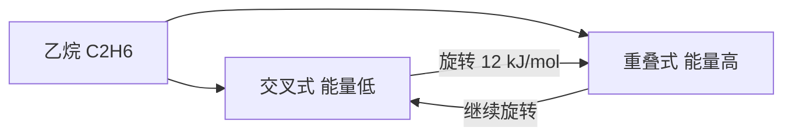

# 第 2 章：烷烃与构象

- **难度**：★★☆ | **预估学时**：1.2 小时 | **前置**：第 1 章、普化第 11 章

## 学习目标
学完本章，你能：
1. 说清 sp³ 杂化与甲烷的四面体结构；
2. 区分乙烷的交叉式和重叠式构象；
3. 写出烷烃的自由基取代反应；
4. 解释烷烃沸点随碳数增加而升高的原因。

## 一句话核心
烷烃的 C—C 单键可以自由旋转，不同旋转角度形成不同构象；化学性质以自由基取代为主。

## 零基础讲解

### 概念 1：sp³ 与四面体（难度：基础）

烷烃碳原子是 sp³ 杂化，四个杂化轨道指向四面体四个顶点，键角 109.5°。甲烷 CH₄ 是正四面体，四个 C—H 键完全等价。

因为四个键等价，甲烷的一氯代物只有一种 CH₃Cl，二氯代物只有一种 CH₂Cl₂。如果甲烷是平面结构，二氯代物会有两种（相邻、相对），实验只发现一种，这反过来证明甲烷是四面体。

### 概念 2：构象（难度：进阶）

C—C 单键可以旋转，同一分子在不同旋转角度下的空间排列叫**构象**。构象之间不经过断键就能互变，所以它们是同一物质的不同形态，不是同分异构体。

乙烷的两种典型构象：
- **交叉式**：两个甲基的氢相互错开，能量最低，最稳定。
- **重叠式**：氢与氢正对，排斥最大，能量最高。

室温下分子碰撞能量足以越过旋转能垒（约 12 kJ/mol），所以乙烷快速在两种构象间转换，平均以交叉式为主。

### 概念 3：自由基取代（难度：进阶）

烷烃在光照下与卤素发生取代，机理是自由基链反应，三步：

1. **链引发**：Cl₂ →(光照) 2Cl·（氯自由基）
2. **链增长**：Cl· + CH₄ → CH₃· + HCl；CH₃· + Cl₂ → CH₃Cl + Cl·
3. **链终止**：Cl· + Cl· → Cl₂；CH₃· + Cl· → CH₃Cl；CH₃· + CH₃· → C₂H₆

选择性：叔氢 > 仲氢 > 伯氢，因为形成的自由基越稳定，反应越容易。所以甲烷氯代会得到多种产物，工业上难以只停在 CH₃Cl。

### 概念 4：烷烃的物理性质（难度：基础）

- 碳数 1–4：气体；5–16：液体；17 以上：固体。
- 沸点随碳数增加而升高：分子越大，色散力越强。
- 同分异构体中，支链越多，沸点越低：支链使分子更接近球形，接触面积小。

烷烃不溶于水，溶于有机溶剂，密度比水小。化学性质稳定，不与酸、碱、KMnO₄ 反应，可作溶剂和燃料。

## 图示

看图说明：能量曲线有两个低点（交叉式）和两个高点（重叠式）。室温下分子轻松越过能垒，所以两种构象快速互变。

## 类比与实例

类比：乙烷的 C—C 键像一根可以转动的轴，两端各挂一个风扇叶片。转到叶片错开时最省力（交叉式），正对时最费劲（重叠式）。这个类比在"构象影响反应选择性"这一点上要补一句：酶和受体识别的是特定构象。

实例：正丁烷有几种构象？沿 C2—C3 键旋转，有对位交叉、邻位交叉、部分重叠、全重叠等，其中对位交叉最稳定。室温下以对位交叉为主。

## 常见误解
- 别以为"构象不同就是不同物质"——不断键就能互变，是同一物质。
- 别以为"烷烃完全没反应"——光照下能与卤素取代，高温下能燃烧、裂解。
- 别以为"支链越多沸点越高"——恰好相反，支链多沸点低。

## 自测题（答案）
1. 甲烷的空间构型是（ ）。A. 平面正方形 B. 正四面体 C. 三角锥 D. 直线形
（答案：B；解析：sp³ 杂化，四个键指向四面体顶点。）

2. 乙烷最稳定的构象是（ ）。
（答案：交叉式；解析：氢与氢错开，排斥最小。）

3. 判断："烷烃能使酸性 KMnO₄ 溶液褪色。"
（答案：不对。烷烃不含不饱和键，不被 KMnO₄ 氧化。）

## 复习锚点
- sp³ 四面体，键角 109.5°。
- 交叉式稳定、重叠式不稳定，构象不断键互变。
- 自由基取代三步：引发、增长、终止。

