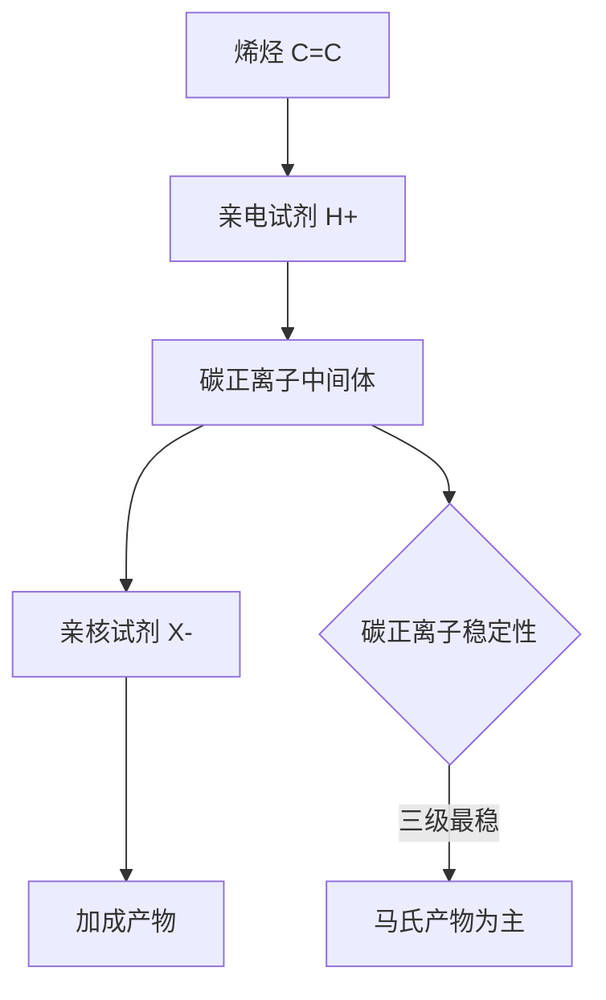

# 第 3 章：烯烃与亲电加成

- **难度**：★★★ | **预估学时**：1.5 小时 | **前置**：第 2 章

## 学习目标
学完本章，你能：
1. 说清 C=C 的 sp² 结构与 π 键；
2. 判断顺反异构；
3. 用马氏规则预测加成产物；
4. 写出烯烃的氧化反应。

## 一句话核心
C=C 由一个 σ 键和一个 π 键组成，π 电子云暴露在外，容易被亲电试剂进攻，发生加成。

## 零基础讲解

### 概念 1：sp² 与 π 键（难度：进阶）

双键碳是 sp² 杂化，三个杂化轨道在同一平面内，键角约 120°。剩下的一个 p 轨道垂直于该平面，两个碳的 p 轨道肩并肩重叠形成 **π 键**。

π 键的特点：电子云在平面上下，暴露在外，容易被亲电试剂进攻；π 键比 σ 键弱，容易断裂，所以烯烃易加成。双键碳不能自由旋转，否则 π 键断裂。

### 概念 2：顺反异构（难度：进阶）

双键不能旋转，当两个双键碳各连两个不同基团时，会出现**顺反异构**。

以 2-丁烯为例：
- 顺式：两个甲基在双键同侧。
- 反式：两个甲基在双键异侧。

判断条件：每个双键碳必须连两个不同的基团。若有一个碳连两个相同的氢，就没有顺反异构。

### 概念 3：亲电加成与马氏规则（难度：高难）

烯烃与 HX、H₂O、X₂ 等加成，分两步：亲电试剂先进攻 π 电子，生成碳正离子中间体；亲核试剂再结合。

马氏规则：不对称烯烃与 HX 加成时，H 加在含氢较多的碳上，X 加在含氢较少的碳上。

例：CH₃CH=CH₂ + HBr → CH₃CHBrCH₃（2-溴丙烷为主）
原因：生成的二级碳正离子比一级碳正离子稳定。碳正离子稳定性：三级 > 二级 > 一级。

反马氏加成：在过氧化物存在下，HBr 与烯烃发生自由基加成，Br 加在含氢多的碳上。这条是特例，要单独记。

### 概念 4：烯烃的氧化（难度：进阶）

- 与酸性 KMnO₄：双键断裂，生成羧酸或酮。RCH=CHR' → RCOOH + R'COOH。可用 KMnO₄ 褪色检验双键。
- 与臭氧（O₃）后还原水解：双键断裂生成醛或酮，可用来确定双键位置。
- 催化加氢：H₂/Ni 或 Pd，生成烷烃。

### 概念 5：聚合（难度：基础）

烯烃加成聚合，双键打开连成长链：
n CH₂=CH₂ →(-CH₂-CH₂-)ₙ（聚乙烯）
工业上聚乙烯、聚丙烯、聚氯乙烯都是这样来的。

## 图示

看图说明：两步加成，第一步决定区域选择性。碳正离子越稳定，路径越容易走。

## 类比与实例

类比：π 键像两个人隔空拉手，力量不如真正握手（σ 键）牢。外来的人一推（亲电试剂），隔空的手就松开，改与新人握手（加成）。这个类比在"碳正离子会重排"这一点上要补一句：中间体还可能变形重组。

实例：丙烯与水加成（酸催化）遵循马氏规则，主要产物是 2-丙醇：
CH₃CH=CH₂ + H₂O →(H⁺) CH₃CH(OH)CH₃

## 常见误解
- 别以为"双键可以自由旋转"——旋转会破坏 π 键，所以有顺反异构。
- 别以为"马氏规则适用于所有加成"——只适用于亲电加成；过氧化物存在下的 HBr 加成是反马氏。
- 别以为"烯烃与溴水反应是取代"——是加成，溴水褪色。

## 自测题（答案）
1. 丙烯与 HBr 加成的主要产物是（ ）。A. 1-溴丙烷 B. 2-溴丙烷 C. 1,2-二溴丙烷 D. 丙醇
（答案：B；解析：马氏规则，H 加在含氢多的碳上。）

2. 下列能发生顺反异构的是（ ）。A. CH₂=CH₂ B. CH₂=CHCH₃ C. CH₃CH=CHCH₃ D. CH₂=C(CH₃)₂
（答案：C；解析：两个双键碳各连两个不同基团。）

3. 判断："烯烃使酸性 KMnO₄ 褪色，是因为发生了加成反应。"
（答案：不对。是氧化反应，双键被氧化断裂。）

## 复习锚点
- sp² 平面，π 键暴露，易亲电加成。
- 马氏规则：H 加到含氢多的碳上，碳正离子稳定性决定方向。
- 酸性 KMnO₄ 褪色可检验双键。

