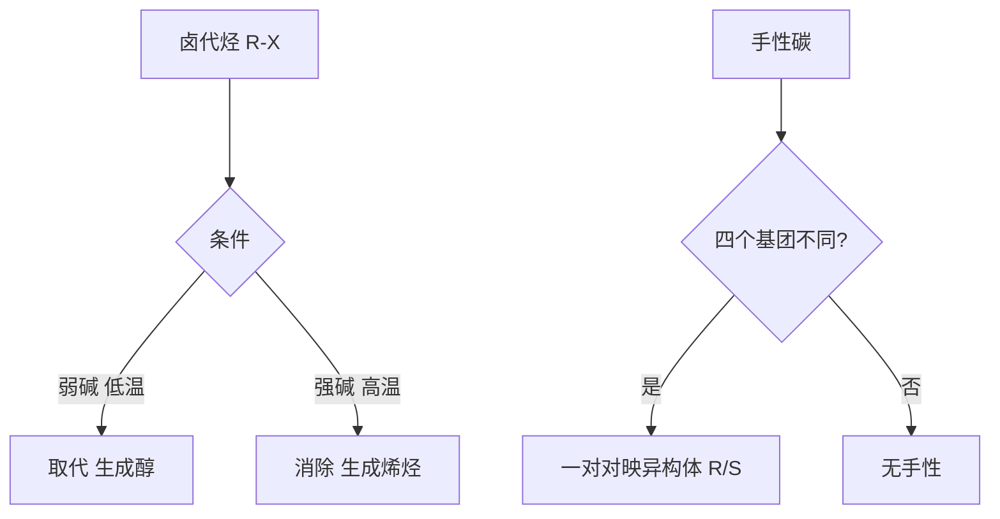

# 第 4 章：芳香烃、卤代烃与立体化学

- **难度**：★★★ | **预估学时**：1.8 小时 | **前置**：第 3 章

## 学习目标
学完本章，你能：
1. 解释苯的芳香性；
2. 写出苯的亲电取代反应；
3. 区分卤代烃的取代和消除；
4. 判断手性碳并写出 R/S 标记。

## 一句话核心
苯环的 π 电子离域使体系特别稳定，所以苯倾向于取代而不是加成；手性来自"四个不同基团连在同一个碳上"。

## 零基础讲解

### 概念 1：苯的结构与芳香性（难度：进阶）

苯 C₆H₆ 是平面正六边形，每个碳 sp² 杂化，剩余 p 轨道形成离域的 π 体系，6 个 π 电子分布在环上。键长介于单键和双键之间，都是 139 pm。

**芳香性**的三个条件（Hückel 规则）：
1. 环状；
2. 平面；
3. π 电子数为 4n+2（n = 0, 1, 2…）。

苯有 6 个 π 电子，4n+2 中 n=1，满足。萘有 10 个，也满足。环丁二烯有 4 个，不满足，不稳定。

芳香性的结果：苯不容易加成（加成会破坏离域体系），容易取代（取代后环仍保持芳香）。

### 概念 2：苯的亲电取代（难度：进阶）

五类典型反应，机理都是"亲电试剂进攻环 → 碳正离子中间体 → 失去 H⁺ 恢复芳香"。

- 卤代：C₆H₆ + Br₂ →(FeBr₃) C₆H₅Br + HBr
- 硝化：C₆H₆ + HNO₃ →(浓H₂SO₄, △) C₆H₅NO₂ + H₂O
- 磺化：C₆H₆ + H₂SO₄(浓) →(△) C₆H₅SO₃H + H₂O
- 傅–克烷基化：C₆H₆ + CH₃Cl →(AlCl₃) C₆H₅CH₃ + HCl
- 傅–克酰基化：C₆H₆ + CH₃COCl →(AlCl₃) C₆H₅COCH₃ + HCl

取代基的定位效应：
- **邻对位定位基**：—OH、—NH₂、—CH₃、—X，使反应更容易，主要上邻位和对位。
- **间位定位基**：—NO₂、—COOH、—SO₃H、—CHO，使反应变难，主要上间位。

### 概念 3：卤代烃的取代与消除（难度：进阶）

卤代烃的 C—X 键极性大，碳带部分正电，容易被亲核试剂进攻。

**取代（SN）**：R—X + OH⁻ → R—OH + X⁻（水解制醇）
**消除（E）**：R—CH₂—CH₂—X + OH⁻ → R—CH=CH₂ + H₂O + X⁻（醇钠、加热，生成烯烃）

两者竞争：强碱、高温有利于消除；弱碱、低温有利于取代。叔卤代烃更容易消除，伯卤代烃更容易取代。

### 概念 4：手性与 R/S（难度：高难）

**手性碳**：连四个不同基团的碳原子。含一个手性碳的分子通常有一对对映异构体，互为镜像、不能重合，就像左右手。

R/S 标记步骤：
1. 把手性碳的四个基团按**次序规则**排优先顺序（原子序数大的优先）。
2. 把最低优先级的基团转向远离观察者（虚线）。
3. 看剩下三个基团的排列方向：顺时针为 R，逆时针为 S。

次序规则：I > Br > Cl > S > O > N > C > H；同种原子比下一层原子。

旋光性：对映异构体能使平面偏振光旋转，一个右旋（+）、一个左旋（−）。等量混合叫外消旋体，旋光相互抵消。

## 图示

看图说明：卤代烃有两条竞争路径，条件决定走哪条。手性只看一个碳上的四个基团是否全不同。

## 类比与实例

类比：苯环像一圈手拉手的人，电子在圈上流动，整体特别稳。想插一个人进来（取代），圈还完整；想两个人分别拉住（加成），圈就断了，所以苯宁可取代。这个类比在"休克尔规则"处要补一句：不是所有环都稳，人数要符合 4n+2。

实例：判断 2-丁醇 CH₃CH(OH)CH₂CH₃ 是否有手性。2 号碳连 —H、—OH、—CH₃、—CH₂CH₃，四个不同，是手性碳，有一对对映异构体。

## 常见误解
- 别以为"苯有单双键交替，所以能加成"——苯的键是离域的，加成会破坏芳香性。
- 别以为"卤代烃水解一定生成醇"——在强碱醇溶液中加热，主要发生消除生成烯烃。
- 别以为"有手性碳就一定有旋光性"——外消旋体旋光抵消，要分离出单一对映体才有旋光。

## 自测题（答案）
1. 苯的硝化反应条件是（ ）。
（答案：浓硝酸、浓硫酸、加热；解析：混酸硝化，浓硫酸作催化剂和脱水剂。）

2. 下列化合物中有手性碳的是（ ）。A. CH₃Cl B. CH₂Cl₂ C. CH₃CHClCH₃ D. CH₃CHClCH₂CH₃
（答案：D；解析：2 号碳连 H、Cl、CH₃、C₂H₅ 四个不同基团。）

3. 判断："苯容易发生加成反应，因为含有 π 电子。"
（答案：不对。苯的离域 π 体系特别稳定，加成会破坏芳香性，所以主要发生取代。）

## 复习锚点
- 芳香性三条件：环状、平面、4n+2 个 π 电子。
- 苯的亲电取代五类：卤代、硝化、磺化、烷基化、酰基化。
- 手性碳四个基团不同，R/S 按次序规则判。

