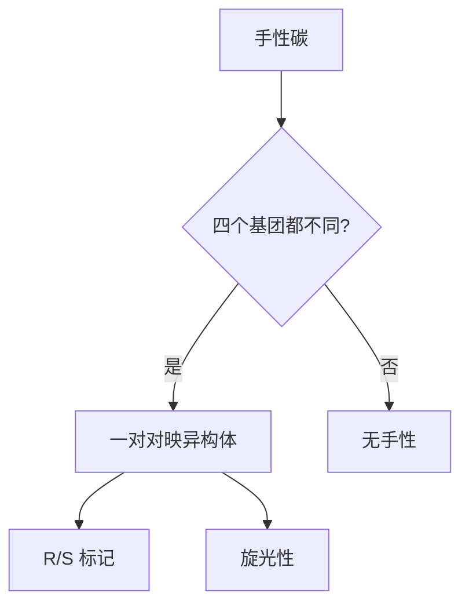

# 手性与对映异构

- **难度**：高难 | **涉及章节**：第 4 章

## 一句话定义
手性是指分子与它的镜像不能重合的性质；含一个手性碳的分子通常有一对互为镜像的对映异构体。

## 为什么重要
药物、氨基酸、糖，全都靠手性起作用。沙利度胺的两种对映体，一种镇吐、一种致畸；人体只能利用左旋氨基酸。不懂手性，有机化学只学了一半。

## 图示

## 详解

判断手性碳：看一个碳上连的四个基团是否全不同。有 H、CH₃、OH、C₂H₅ 四个不同基团，就是手性碳。

R/S 标记：按次序规则排优先级（原子序数大的优先），把最低优先级基团转向远离观察者，剩下三个顺时针为 R、逆时针为 S。

对映异构体物理性质相同（熔点、沸点、溶解度），只有旋光方向相反。等量混合是外消旋体，旋光抵消。

## 常见误解
- 别以为"有手性碳就一定有旋光性"——外消旋体没有。
- 别以为"手性分子一定含手性碳"——有些联苯、丙二烯型分子没有手性碳也有手性。
- 别以为"对映体化学性质完全相同"——在非手性环境中相同，在手性环境（如酶）中反应速率不同。

## 在书中出现的脉络
| 章节 | 语境 | 关键结论 |
|---|---|---|
| 有机第 1 章 | 同分异构 | 立体异构是一类 |
| 有机第 4 章 | 手性碳 | R/S 标记 |
| 有机第 4 章 | 药物 | 对映体药效不同 |

## 相关概念
- 前置：构造式、同分异构
- 后续：不对称合成、酶催化
