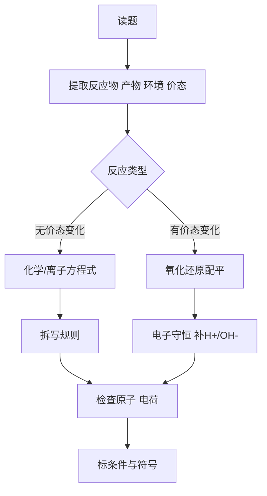

# 第 1 章：陌生方程式书写的五步法

- **难度**：★★★ | **预估学时**：1.5 小时 | **前置**：入门篇第 4、6、7 章

## 学习目标
学完本章，你能：
1. 从一段陌生信息里提取反应物、产物、环境和价态；
2. 判断该写化学方程式、离子方程式还是电极反应式；
3. 按五步法配平并检查电荷、原子、条件；
4. 避开"该拆不拆、该标不标、电荷不平"三类高频失分点。

## 一句话核心
陌生方程式不是靠背，而是靠"信息 → 类型 → 产物 → 配平 → 检查"这条固定流水线，一步一步推出来。

## 零基础讲解

### 概念 1：第一步，把信息拆成四件事（难度：基础）

拿到题先划四样东西：
- **反应物**：谁和谁反应，注意"少量""过量""适量"。
- **产物线索**：题里明说的产物、颜色变化、气体、沉淀。
- **环境**：酸性、碱性、中性，还是熔融盐、水溶液。
- **价态变化**：有没有元素化合价升降，这是判断氧化还原的关键。

例："向含碘废液中加入稍过量的 Na₂SO₃ 溶液，将 I₂ 还原为 I⁻"。反应物 I₂、SO₃²⁻；产物 I⁻、SO₄²⁻；环境水溶液；S 从 +4 升到 +6，I 从 0 降到 −1，是氧化还原。

### 概念 2：第二步，判断反应类型（难度：进阶）

三类方程式，写法不同：
- **化学方程式**：写完整化学式，标状态和条件。
- **离子方程式**：可溶强电解质拆成离子，难溶物、气体、水、弱电解质不拆。
- **电极反应式**：分正负极（或阴阳极），标电子得失，注意电解质环境（酸性/碱性/熔融碳酸盐）。

判断依据是题目问什么。问"离子方程式"就不能写化学方程式；问"正极反应式"就不能写总反应。

### 概念 3：第三步，定产物（难度：高难）

产物不能瞎猜，按三条线索定：
1. **价态守恒**：氧化还原中，升多少、降多少要配平。常见产物：Fe²⁺/Fe³⁺、Mn²⁺/MnO₂、Cr³⁺/Cr₂O₇²⁻、SO₂/SO₄²⁻、NO/NO₃⁻。
2. **环境守恒**：酸性条件补 H⁺ 和 H₂O；碱性条件补 OH⁻ 和 H₂O；熔融碳酸盐中补 CO₃²⁻ 和 CO₂。
3. **元素守恒**：C、N、S 等元素的去向要合理，比如 CN⁻ 被氧化成 CNO⁻ 再进一步氧化成 N₂ 和 CO₂。

### 概念 4：第四步，配平（难度：高难）

配平顺序：先电子，再原子，最后电荷。

以酸性条件下 KMnO₄ 氧化 H₂C₂O₄ 为例：
1. 标价：Mn +7→+2（得 5e），C +3→+4（每个 C 失 1e，H₂C₂O₄ 有两个 C，共失 2e）。
2. 电子守恒：2MnO₄⁻ 得 10e，需要 5H₂C₂O₄ 失 10e。
3. 配原子：2MnO₄⁻ + 5H₂C₂O₄ → 2Mn²⁺ + 10CO₂。
4. 补 H⁺ 和 H₂O：左边 10 个 H，右边需要 10H⁺？先数 O：左边 8 + 20 = 28，右边 20，差 8 个 O，补 8H₂O 在右边；H 左边 10，右边 10H⁺ + 16H（8H₂O）= 26，不平。重算：2MnO₄⁻ + 5H₂C₂O₄ + 6H⁺ → 2Mn²⁺ + 10CO₂ + 8H₂O。
检查：Mn2，C10，O 8+20=28 → 20+8=28；H 10+6=16 → 16；电荷 −2−6+6=−2，右边 +4−? 2Mn²⁺ = +4，电荷 +4，不平。调整 H⁺：需要 −2 + x = +4 → x = 6，已写 6H⁺，左边电荷 −2 + 6 = +4，右边 +4，平。H：左边 10+6=16，右边 8H₂O=16，平。正确：2MnO₄⁻ + 5H₂C₂O₄ + 6H⁺ → 2Mn²⁺ + 10CO₂↑ + 8H₂O。

这段推导说明：配平不是一次成功，数是靠"电荷平"倒推 H⁺ 个数。考试时按这个顺序检查，比死记系数可靠。

### 概念 5：第五步，检查四件事（难度：进阶）

1. **原子守恒**：每种元素左右相等。
2. **电荷守恒**：离子方程式左右电荷代数和相等。
3. **电子守恒**：氧化还原得失电子总数相等。
4. **符号规范**：气体 ↑、沉淀 ↓、条件（点燃、加热、催化剂）、可逆号。

## 图示

看图说明：两条分支的区别只在"有没有价态变化"。有价态变化的题，电子守恒是主线；没有的题，拆写规则是主线。

## 类比与实例

类比：写陌生方程式像拼装家具。说明书只给几张图（题目信息），你得先认出零件（反应物）、看明白成品长什么样（产物线索）、按装配顺序装（配平）、最后检查螺丝有没有拧紧（守恒检查）。这个类比在"产物需要自己推断"这一点上要补一句：家具图给了成品，化学题常常不给，要靠价态和环境推。

实例：写出 Na₂S₂O₃ 在酸性溶液中分解的离子方程式。
信息：S₂O₃²⁻ 在酸性条件下不稳定，生成黄色沉淀（硫）和刺激性气体（SO₂）。
价态：S 平均 +2，一部分升到 +4（SO₂），一部分降到 0（S）。
配平：S₂O₃²⁻ → S + SO₂，先让 S 守恒：S₂O₃²⁻ → S + SO₂ 已有 2 个 S；O 3 → 2，差 1 个 O，补 H₂O；H 补 H⁺。
S₂O₃²⁻ + 2H⁺ → S↓ + SO₂↑ + H₂O。检查：S2，O3=2+1，H2，电荷 −2+2=0。正确。

## 常见误解
- 别以为"题里没说的产物不能写"——产物常常要自己推，推的依据是价态、环境、元素守恒。
- 别以为"离子方程式里所有化合物都要拆"——难溶物、气体、水、弱电解质、氧化物不拆。
- 别以为"配平只要原子平就行"——离子方程式还必须电荷平，氧化还原还必须电子平。

## 自测题（答案）
1. 写出 Cl₂ 在碱性条件下氧化 CN⁻ 为 CNO⁻ 的离子方程式。
（答案：CN⁻ + ClO⁻ → CNO⁻ + Cl⁻；解析：Cl₂ 在碱性条件下先生成 ClO⁻，Cl 从 0 降到 −1，C 从 +2 升到 +4，1:1 配平。）

2. 写出酸性条件下 MnO₂ 氧化 H₃AsO₃ 的离子方程式。
（答案：H₃AsO₃ + MnO₂ + 2H⁺ → H₃AsO₄ + Mn²⁺ + H₂O；解析：As +3→+5 失 2e，Mn +4→+2 得 2e，1:1；补 2H⁺ 和 1H₂O。）

3. 判断："离子方程式两边只要原子守恒，电荷可以不守恒。"
（答案：不对。电荷必须守恒，这是离子方程式的硬性要求。）

## 复习锚点
- 五步：读信息 → 判类型 → 定产物 → 配平 → 检查。
- 酸性补 H⁺，碱性补 OH⁻，熔融碳酸盐补 CO₃²⁻。
- 三守恒：原子、电荷、电子。
