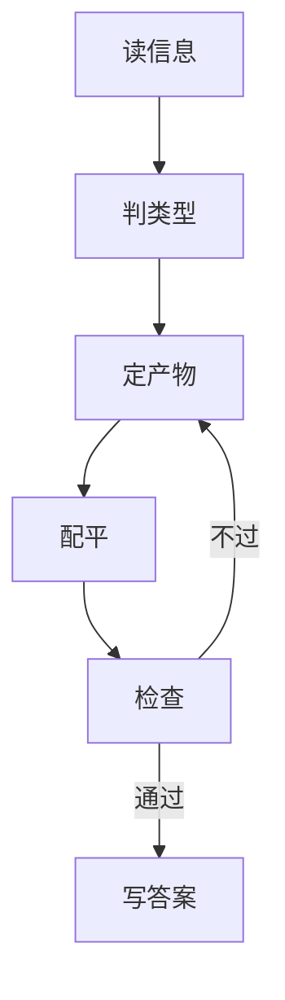

# 陌生方程式五步法

- **难度**：进阶 | **涉及章节**：第 1 章

## 一句话定义
把陌生方程式拆成"读信息 → 判类型 → 定产物 → 配平 → 检查"五个固定步骤，按顺序推进。

## 为什么重要
考试里的方程式题，90% 不是不会化学，而是漏了某一步：产物猜错、该拆没拆、电荷不平。固定流程能把"凭感觉"变成"按清单核对"。

## 图示

## 详解

读信息时划四样：反应物、产物线索、环境、价态。这一步决定后面所有判断。

判类型：问化学方程式、离子方程式还是电极反应式。类型不同，拆写和符号规则不同。

定产物：氧化还原看价态升降，非氧化还原看复分解条件（沉淀、气体、水），电极反应看电解质环境。

配平：先电子守恒，再原子守恒，最后电荷守恒。酸性补 H⁺，碱性补 OH⁻，熔融碳酸盐补 CO₃²⁻。

检查：原子、电荷、电子、符号四件事。

## 常见误解
- 别以为"产物题里没写就不能写"——多数产物要自己推。
- 别以为"配平一次就能成"——电荷不平就回去改 H⁺/OH⁻ 个数。
- 别以为"写对就行，符号无所谓"——气体、沉淀、条件都是得分点。

## 在书中出现的脉络
| 章节 | 语境 | 关键结论 |
|---|---|---|
| 陌生第 1 章 | 五步法 | 固定流程 |
| 入门第 4、6、7 章 | 基础 | 配平、拆写、氧化还原 |

## 相关概念
- 前置：离子方程式、氧化还原
- 后续：电极反应、工艺流程题
